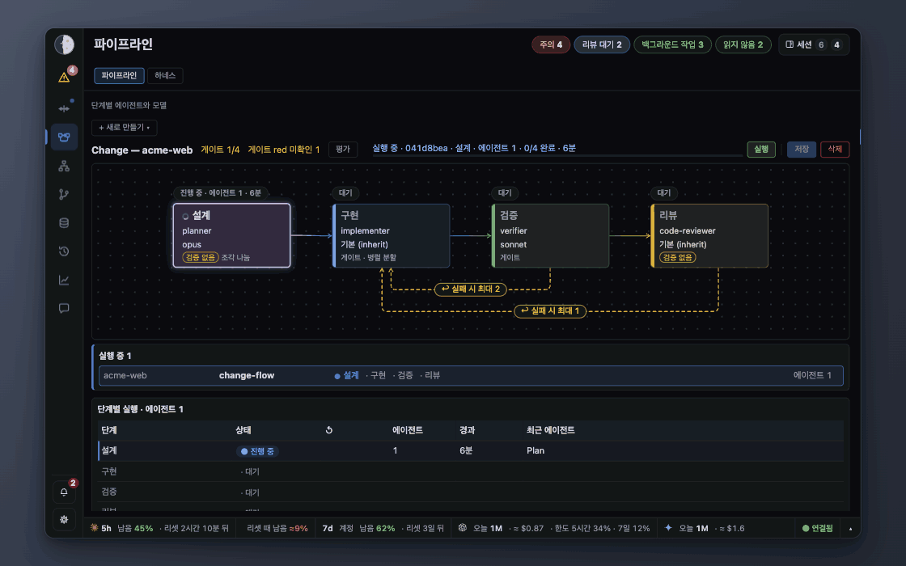
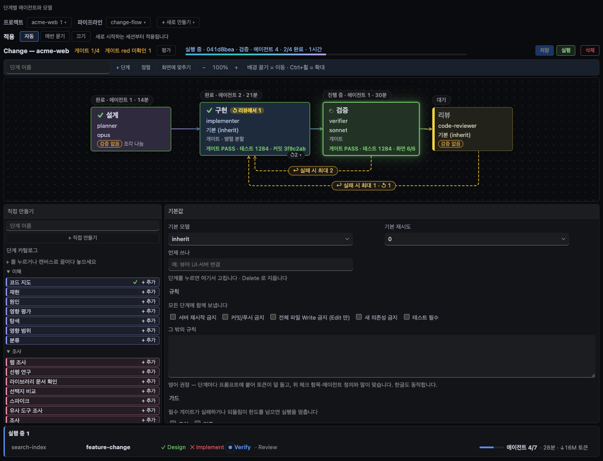
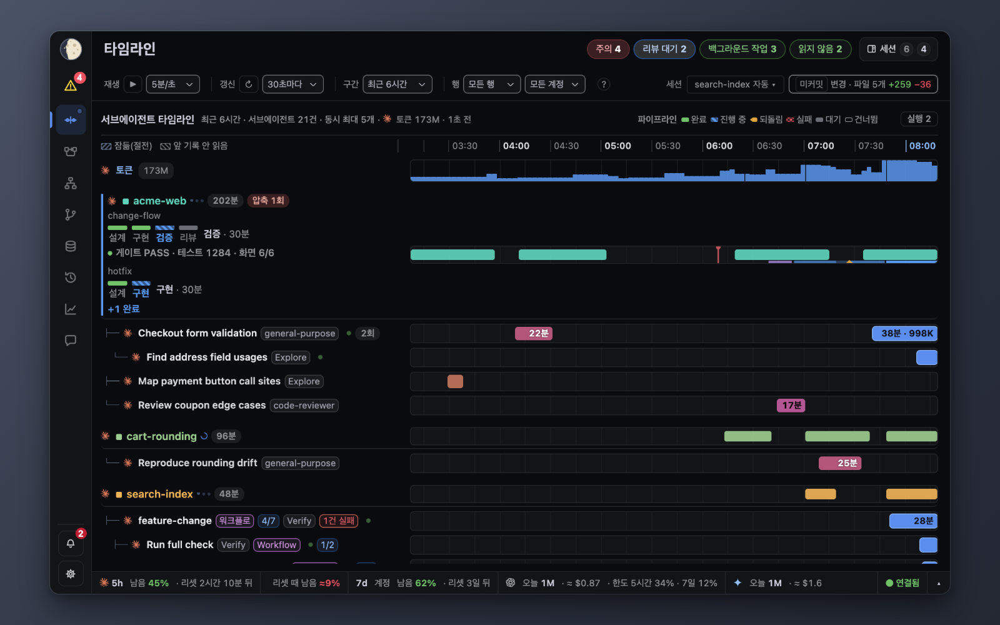
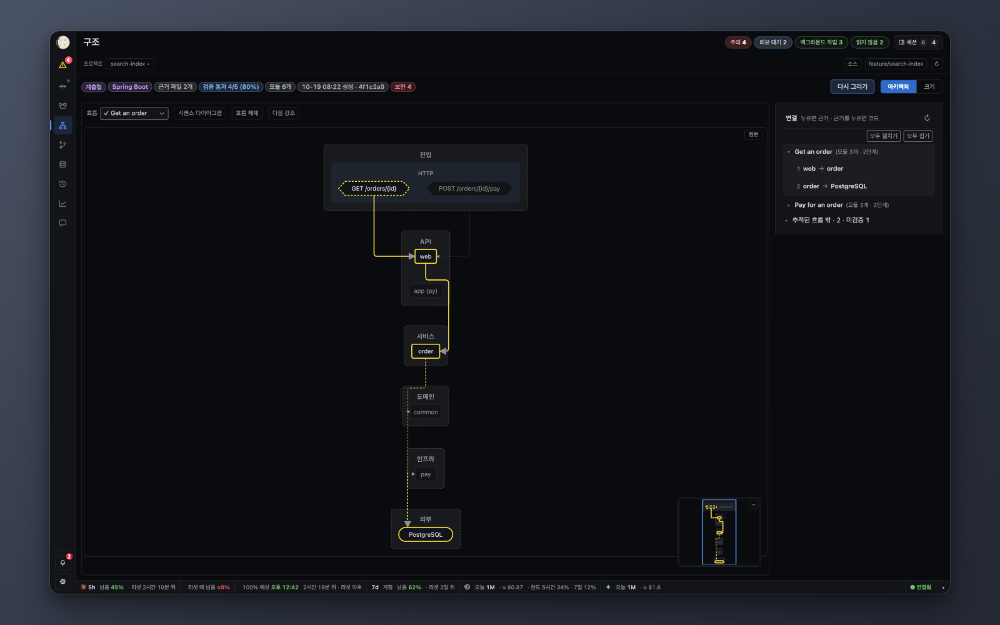
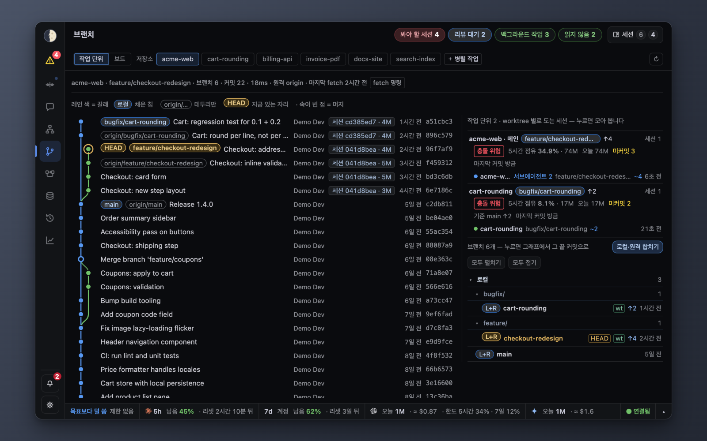
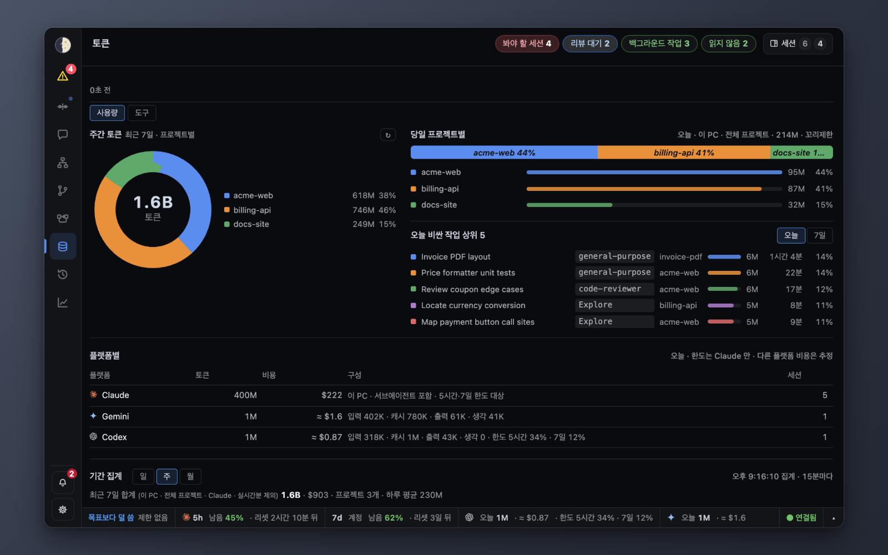

# Sidereus

[English](README.md) · **한국어**

[](LICENSE)


**여러 AI 코딩 세션을 검증하는 로컬 관측소입니다.**

여러 세션의 결과와 과정을 한 화면에서 확인하고, 판단하고, 지시를 전달합니다.

각자의 터미널에서 이미 돌고 있는 Claude Code, Codex CLI, Gemini CLI 세션 옆에서 동작하며, 여러 세션을 동시에
돌리는 개발자 한 명을 위해 만들었습니다. 에이전트를 실행하거나 터미널을 조작하지 않습니다.
메타데이터만 다루며, 예외는 클릭해야 열리는 작업 팝업 하나뿐입니다([개인정보](#개인정보)).



파이프라인 실행 한 번을 단계별로 보여 줍니다. 리뷰에서 한 번 되돌렸으며, 그 되돌림도 실행 기록에 남습니다.

합성 데이터로 먼저 둘러볼 수 있습니다. 이때 실제 데이터는 읽지 않습니다.

```sh
git clone https://github.com/bugsterran/sidereus.git ~/sidereus && cd ~/sidereus
python3 -m sidereus start --demo --open      # 18799 포트, Ctrl-C로 끕니다. Windows: py -m sidereus
```

## 하는 일

같은 세션을 세 갈래로 연결해 봅니다.

- **파이프라인** — 단계 순서를 한 번 정해 두면 단계마다 진행 상황과 게이트 증거가 보입니다.
- **타임라인** — 각 에이전트가 실제로 한 일을 보여 주고, 그 위에 파이프라인 단계를 겹쳐 표시합니다.
- **구조 분석** — AI가 그린 아키텍처 지도를 특정 커밋의 코드(파일·줄·심볼)와 대조해 확인합니다.

**결과마다 근거를 남깁니다.**

- 파이프라인 단계마다 게이트 PASS/FAIL, 테스트, 커밋, 그리고 PASS가 나중에 다시 깨졌는지를 기록합니다.
- 가드는 필수 게이트를 통과하기 전에는 `git commit`을 막습니다(Claude Code 전용, 훅으로 동작. [HOOKS.ko.md](docs/HOOKS.ko.md) 참고).
- 일부러 심은 버그로 게이트가 실제로 잡아내는지 확인합니다.

**여러 CLI·계정·프로젝트를 한 화면에서 봅니다.**

- Claude Code는 트랜스크립트로 읽고, Codex CLI와 Gemini CLI는 훅으로 상태를 받습니다.
- 다른 CLI(Cursor, Copilot 등)도 같은 훅으로 연결할 수 있지만 아직 확인하지 않았습니다.

같은 화면에는 다음도 표시됩니다.

- 내 손이 필요한 정도에 따른 세션 순위. 막힘·질문 세션은 맨 위에 남습니다
- 남은 할당량, 그리고 지금 고치려는 파일을 수정 중인 다른 세션
- 메일박스로 세션에 보낸 지시와 그 기록

## 적용 범위

이런 경우에 맞습니다.
- 터미널에서 여러 CLI 세션을 도구·계정·프로젝트를 넘나들며 돌릴 때(Claude Code가 먼저, Codex·Gemini 등은 어댑터로)
- 대화 내용을 외부 서비스로 보낼 수 없을 때
- 파이프라인에서 품질 게이트를 돌릴 때

이런 경우에는 맞지 않습니다.
- IDE 안에서 에이전트 한두 개만 쓸 때
- Claude Code만 쓰고 기다리는 세션을 먼저 보는 것으로 충분할 때. Claude Code 자체의 agent view로 됩니다
- 클라우드 실행이나 조직 단위 거버넌스가 필요한 팀

개인이 쓰던 도구를 포크해서 쓰도록 공개했습니다. UI는 한국어와 영어를 지원하지만, 기본값은 만든 사람의
작업 방식을 따르고 macOS를 전제한 부분이 남아 있습니다. Anthropic과는 관계가 없으며 승인받은 프로젝트도
아닙니다. 제3자 고지: [THIRD_PARTY_NOTICES.md](THIRD_PARTY_NOTICES.md).

설계와 범위: [docs/CONCEPT.ko.md](docs/CONCEPT.ko.md).

## 요구 사항

- Python 3.9 이상. 표준 라이브러리만 사용합니다. macOS 기본 `/usr/bin/python3`로 동작합니다. 새 Mac에서는
  처음 실행할 때 Xcode Command Line Tools 설치 창이 뜨는데, 설치를 마친 뒤 명령을 다시 실행하면 됩니다.
- 사용량: `--demo` 서버 RSS 약 30MB, 배포 코드 약 10MB (macOS, Python 3.9, 2026-10-16 측정).
- Claude Code. 뷰어는 `~/.claude/projects/` 아래의 트랜스크립트를 읽습니다(`CLAUDE_CONFIG_DIR`가 설정돼 있으면 `$CLAUDE_CONFIG_DIR/projects/`).
- 브랜치·구조·diff 화면을 쓰려면 `git`이 필요합니다.
- macOS에서 테스트했습니다. Windows 11은 실제 PC에서 확인했습니다(2026-10-17). Windows에서 꺼지거나
  아직 확인하지 못한 기능은 [시작하기](docs/GETTING-STARTED.ko.md#2-뷰어-띄우기)에 정리했습니다. Linux는 테스트하지 않았습니다.

## 설치 전에

- macOS에서는 사용량 조회를 위해 키체인의 Claude Code 토큰을 읽어 `api.anthropic.com`에 보냅니다. 밖으로 나가는 요청은 이것 하나입니다(`"quota_lookup": false`로 끔). 세션이 일하는 동안 `caffeinate`를 겁니다(`"keep_awake": false`로 끔).
- 훅은 이 컴퓨터의 모든 Claude Code 세션에 걸립니다. `.claude/pipelines/*.json`이 있는 프로젝트에서는 순서를 건너뛴 단계나 이른 `git commit`을 막을 수 있습니다([자세히](#에이전트에서-쓰기-mcp)).
- 여러 계정이 함께 쓰는 Mac에서는 다른 계정도 이 뷰어의 API를 부를 수 있습니다. 루프백 말고는 인증이 없습니다([SECURITY.ko.md](SECURITY.ko.md#모델)).
- 키체인·네트워크·AppleScript·파일에 접근하는 부분과, 기본으로 꺼진 유료 할당량 탐침은 [SECURITY.md](SECURITY.md), [CONFIG.ko.md](docs/CONFIG.ko.md)에 있습니다.

## 설치

```sh
git clone https://github.com/bugsterran/sidereus.git ~/sidereus && cd ~/sidereus
python3 -m sidereus start --open             # http://127.0.0.1:8799. Windows: sidereus.cmd start --open
```

Windows에서는 문서의 `python3`를 `py`로 바꿔 쓰거나, 클론 폴더에서 `sidereus.cmd`를 실행하세요.
Windows는 Python·Git for Windows·Claude Code를 먼저 설치합니다: [시작하기 0장](docs/GETTING-STARTED.ko.md#0-준비).
화면만 쓴다면 설치는 이것으로 끝입니다. 명령·포트·로그인 시 자동 실행은 [시작하기 2~3장](docs/GETTING-STARTED.ko.md#2-뷰어-띄우기)을 보세요.

8799가 이미 쓰이고 있으면(다른 클론, 또는 같은 Mac의 다른 계정이 띄운 Sidereus) `status`는 8799에 무언가 응답하지만
실행 기록은 없다고만 말하고, `lsof`에도 다른 계정의 프로세스는 보이지 않습니다. 빈 포트를 고르세요:

```sh
python3 -m sidereus start --port 8800 --open   # 포트는 config.local.json에 저장되고, MCP 서버도 이 포트를 따라갑니다
```

Claude Code 연결은 플러그인과 수동 훅 중 하나만 고릅니다([5장](docs/GETTING-STARTED.ko.md#5-mcp-와-훅)). 플러그인은 Claude Code 안에서:

```text
/plugin marketplace add ~/sidereus
/plugin install sidereus@sidereus
```

훅과 MCP 도구는 설치 뒤에 시작한 세션에만 걸리므로 Claude Code를 한 번 다시 시작하세요.

설치 확인: `python3 -m sidereus status`에 `200`과 pid가 나오면 됩니다. 새 세션에서 `sidereus_peers`를 불러 보면
그 세션이 목록에 보여야 합니다.

제거: [시작하기](docs/GETTING-STARTED.ko.md#제거).

## 개인정보

다른 세션의 대화 내용은 화면에 표시하지 않습니다. 목록·타임라인·카드·MCP 서버에는 메타데이터만 들어갑니다.
경로, 세션 id, 모델, 상태, 개수, 에이전트의 한 줄 작업 설명이 전부이며, 이 규칙은 코드로 강제합니다.

예외는 작업 팝업 하나입니다. 세션이나 에이전트를 클릭하면 해당 트랜스크립트의 끝부분을 읽어 최근 지시,
답변, 도구 사용 흔적, 파일 diff를 보여 줍니다. 클릭했을 때만, 그리고 이 기기에서 도는 세션의 저장소일 때만
열립니다(diff와 같은 허용 목록).

## 화면 구성

| 영역 | 보여 주는 것 |
|---|---|
| 왼쪽 레일 · Attention | 지금 나를 기다리는 세션. «Attention»은 내 손이 필요한 정도대로 세션을 줄 세우고, 줄마다 완료·나중에·답장이 있습니다. 레일을 접었을 때는 배지를 누르면 목록이 잠깐 펼쳐집니다. 레일에는 탭·종·설정도 있습니다. |
| 상태 표시줄 | 리셋 전에 한도가 바닥나는지. 5시간·7일 사용량과 리셋 때 남을 예상 여유. 누르면 계정별 한도·열린 세션이 보이고 메인 계정을 바꿀 수 있습니다. |
| 세션 서랍 | 살아 있는 세션과 각 상태(실행·생각·답 대기·끝남·멈춤) |
| 종 | 무엇이 실패했고 어떻게 대처하면 되는지. OS 알림은 선택 사항이며 기본으로 꺼져 있습니다. |
| 타임라인 | 세션과 서브에이전트가 언제 무엇을 했는지. «변경» 칩이 기준 대비 바뀐 파일 수를 보여 주고(두 세션이 같은 파일을 건드리면 «⚠ 공유 n개») 누르면 diff 가 열립니다. |
| 채팅 | 세션 사이의 메일박스 방과 DM. 직접 글을 쓸 수도 있습니다. |
| 토큰 | 모델·프로젝트·플랫폼별 토큰과 비용, 가장 비싼 서브에이전트 실행 5개 |
| 파이프라인 | 프로젝트마다 선언한 단계와 에이전트·모델, 진행 중인 실행, 단계별 근거(게이트 PASS/FAIL, 테스트, 커밋, 되돌림). 실행 요청은 메일박스로 세션에 보냅니다. |
| 구조 | 에이전트가 그리고 연결마다 코드로 검증한 모듈 구조도, 진입점마다 하나씩인 처리 흐름, 미니맵, 코드가 커져 온 과정(트리맵). 모듈별 보안 검사(비밀값·의존성·SAST). «개선 요청»은 결과를 세션에 보내고, 수정을 커밋한 뒤 구조도를 다시 그려 달라고 함께 요청합니다. |
| 브랜치 | 커밋마다 어느 세션이 만들었고 비용이 얼마였는지, worktree별 커밋하지 않은 수정, 충돌 위험 |
| 기록 | 지난 세션을 날짜별·작업 단위별로 정리 |
| 인사이트 | 최근 30일의 실패와 도구 오류 |



| **타임라인**: 서브에이전트가 언제 무엇을 했는지, 도구 줄의 «변경» 칩과 함께 | **구조**: 아키텍처 구조도. 흐름을 고르면 진입점부터 이어지는 경로와 연결마다의 근거가 보입니다 |
|---|---|
|  |  |
| **브랜치**: 커밋마다 어느 세션이 만들었는지, worktree별 충돌 위험 | **토큰**: 프로젝트별 주간 사용량, 오늘 비싼 작업, 플랫폼별 합계 |
|  |  |

`≈`가 붙은 숫자는 추정치입니다. 공식 할당량 %의 기준이 되는 토큰 상한은 공개되지 않아서 Sidereus가 주기마다
역산하며, 몇 주기가 지나면 값이 수렴합니다.

세션은 내 손이 얼마나 필요한지에 따라 정렬합니다. 막힘, 질문에 대한 답 대기, 파일 충돌이 맨 앞이고 끝난
세션이 맨 뒤입니다. 점수 계산은 `sidereus/attention.py`에 있습니다.

스크린샷과 함께 보는 사용법은 [docs/GUIDE.ko.md](docs/GUIDE.ko.md)에 있습니다.

## 동작 방식

서버는 트랜스크립트, git, OpenTelemetry 로그를 백그라운드 스레드와 증분 캐시로 읽고, `127.0.0.1:8799`에서
화면과 MCP 서버로 제공합니다. Claude 토큰은 쓰지 않습니다. MCP를 한 번 호출하면 호출한 세션의 컨텍스트에
몇 줄이 추가됩니다. 구조도와 자세한 내용은 [docs/ARCHITECTURE.ko.md](docs/ARCHITECTURE.ko.md)를 참고하세요.

## 에이전트에서 쓰기 (MCP)

플러그인을 설치했다면 이미 등록돼 있습니다(Windows에서는 먼저 `setx SIDEREUS_PYTHON py`를 실행하세요. [5장](docs/GETTING-STARTED.ko.md#5-mcp-와-훅) 참고). 직접 등록하려면 클론 폴더에서 아래 명령을 실행합니다(macOS 기준.
Windows에서는 클론 안에서 `py -m sidereus setup-claude`를 실행해 나온 `claude mcp add` 명령을 쓰세요).

```sh
claude mcp add --scope user sidereus -- /usr/bin/python3 "$PWD/mcp/sidereus_mcp.py"
```

| 도구 | 반환값 |
|---|---|
| `sidereus_quota` | 5시간·7일 사용 %, 남은 토큰, 리셋 시각, 목표 대비 속도, 권고 한 줄 |
| `sidereus_file_peers(path)` | 최근 30분 안에 이 파일을 수정한 다른 세션, 살아 있는지 여부, 커밋하지 않은 수정 여부 |
| `sidereus_peers()` | 같은 저장소(worktree 무관)의 살아 있는 세션·서브에이전트와 상태·도구·컨텍스트 % |
| `sidereus_attention()` | 사용자를 기다리는 세션 |

뷰어가 실행 중이어야 하고, `claude mcp add` 이후에 시작한 세션에서만 도구가 보입니다. 에이전트는 따로 시키지
않으면 이 도구를 잘 호출하지 않으므로 `AGENTS.md`나 `CLAUDE.md`에 규칙을 적어 두세요. 자세한 내용은
[docs/MCP.ko.md](docs/MCP.ko.md)를 참고하세요.

Sidereus는 세션을 시작하거나 멈추지 않습니다. 파이프라인 훅(`pl_mark`, `pl_flow`, `pl_guard`)은 `.claude/pipelines/*.json`이
있는 프로젝트에서만 호출을 거부할 수 있습니다. 대상은 태그 없는 Agent 호출, `[pl:<이름>/<단계>]` 실행에서 순서를 건너뛴 단계,
그 실행의 `guards` 게이트를 통과하기 전의 `git commit`입니다. 프로젝트별로 «적용»에서 끕니다. 자세한 내용은 [HOOKS.ko.md](docs/HOOKS.ko.md).

## 문서

| 문서 | 내용 |
|---|---|
| [docs/GETTING-STARTED.ko.md](docs/GETTING-STARTED.ko.md) | 단계별 설치와 설정 |
| [docs/GUIDE.ko.md](docs/GUIDE.ko.md) | 자주 하는 작업, 스크린샷 포함 |
| [docs/CONFIG.ko.md](docs/CONFIG.ko.md) | 경로, 설정 키, 환경 변수, launchd, 백업 |
| [docs/HOOKS.ko.md](docs/HOOKS.ko.md) | 훅, Codex·Gemini CLI 연결, 메일박스 Stop 훅 |
| [docs/MCP.ko.md](docs/MCP.ko.md) | `sidereus` MCP 서버 |
| [docs/PARALLEL-WORK.ko.md](docs/PARALLEL-WORK.ko.md) | 병렬 worktree (`claude -w <이름> --tmux`) |
| [docs/STRUCTURE.ko.md](docs/STRUCTURE.ko.md) | 구조 탭: 아키텍처 구조도와 흐름, 크기 트리맵, 지원 언어 |
| [docs/ARCHITECTURE.ko.md](docs/ARCHITECTURE.ko.md) | 서버·화면·훅·메일박스의 연결 구조 |
| [docs/EXTENDING.ko.md](docs/EXTENDING.ko.md) | CLI 플랫폼·언어 플러그인·파이프라인 추가 |
| [docs/REVIEW-PIPELINES.ko.md](docs/REVIEW-PIPELINES.ko.md) | 플랫폼 공개 자료에 기반한 CLI 별 리뷰 파이프라인과 템플릿 |
| [docs/schema/sidereus-state.v1.json](docs/schema/sidereus-state.v1.json) | `GET /api/v1/state`의 안정 메타데이터 스키마 |

## 설정 바꾸기

설정(톱니바퀴)에서 언어, 배경 톤, «내 방식»을 바꿀 수 있습니다. 서버 쪽 값은 `config.local.json`에 저장되며
재시작해야 적용됩니다. `/usr/bin/python3 mailbox_config.py`(Windows: `py mailbox_config.py`)를 실행하면 설정 파일 경로와 병합된 결과를 볼 수
있습니다. 전체 키와 설정 API는 [docs/CONFIG.ko.md](docs/CONFIG.ko.md)에 있습니다.

## 다른 CLI

Gemini CLI와 Codex CLI는 훅으로 상태를 보내 Claude Code 세션 옆에 함께 표시되고, 토큰도 따로 집계됩니다.
⚠ 이 토큰은 Claude의 5시간·7일 한도나 비용에 절대 합산하지 않습니다. 설정 방법은 [docs/HOOKS.ko.md](docs/HOOKS.ko.md)를 보세요.

⚠ Codex는 TUI에서 `/hooks`로 한 번 승인하기 전까지 `hooks.json`을 무시하며, 파일을 수정할 때마다 다시
승인해야 합니다. 승인 전에는 Codex 세션이 목록에 나타나지 않습니다.

## 프로젝트 운영 방식

- 있는 그대로 공개합니다. 핵심 기능을 바꾸고 싶다면 포크해 주세요.
- 버그 리포트는 환영합니다. PR은 확장 기능(언어 플러그인, CLI 어댑터, 파이프라인 템플릿)만 받습니다.
  자세한 내용은 [CONTRIBUTING.md](CONTRIBUTING.md)를 참고하세요.
- 보안 모델과 비공개 신고 방법은 [SECURITY.md](SECURITY.md), 변경 기록은 [CHANGELOG.md](CHANGELOG.md)에 있습니다.

[ccusage](https://github.com/ryoppippi/ccusage)(5시간 블록 규칙, `message.id` + `requestId` 중복 제거 키),
Grafana, Datadog, Paseo, Orca, SourceTree, Conductor, Codex, Vibe Kanban에서 아이디어를 얻었습니다. 코드는 직접 작성했습니다.

## 라이선스

MIT 라이선스입니다. [LICENSE](LICENSE)를 참고하세요.
