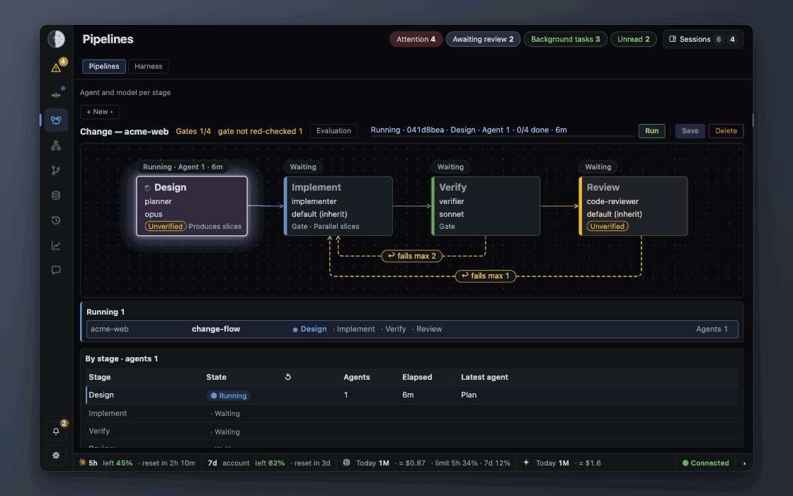

# Sidereus

**English** · [Korean](README.ko.md)

[](LICENSE)

-lightgrey.svg)

**A local observatory for verifying AI coding sessions.**

One screen to check the results and the process of several sessions, judge them, and direct them by relaying instructions.

It runs beside the Claude Code, Codex CLI and Gemini CLI sessions already open in your terminals, and is built
for one developer running several sessions at once. It never runs your agents or touches your terminal.
Metadata only; the one exception is a work popup you open by click ([Privacy](#privacy)).



One pipeline run, stage by stage. Review sent the work back once; the loop-back is recorded with the run.

Try it with synthetic data (nothing real is read):

```sh
git clone https://github.com/bugsterran/sidereus.git ~/sidereus && cd ~/sidereus
python3 -m sidereus start --demo --open      # port 18799, Ctrl-C stops it. Windows: py -m sidereus
```

## What it does

Three connected views of the same sessions:

- **Pipelines** — declare the stage order once; each stage shows progress and gate evidence.
- **Timeline** — what each agent actually did, with pipeline stages overlaid.
- **Structure analysis** — an AI-drawn architecture map, checked against the code (file, line, symbol) at a commit.

**Evidence for each result.**

- Each pipeline stage records gate PASS/FAIL, tests, the commit, and whether the PASS broke again later.
- Guards block a `git commit` until the required gates pass (Claude Code only, through hooks; see [HOOKS.md](docs/HOOKS.md)).
- A bug planted on purpose checks that a gate actually catches it.

**One screen across CLIs, accounts and projects.**

- Claude Code is read from its transcripts; Codex CLI and Gemini CLI report through hooks.
- Other CLIs (Cursor, Copilot and more) can report through the same hook, not yet verified.

The same screen also shows:

- sessions ranked by how much they need you; blocked and asking sessions stay at the top
- quota left, and which other sessions are editing the file you are about to touch
- instructions sent to a session through the mailbox, kept on record

## Scope

For:
- several CLI sessions run from a terminal, across vendors, accounts or projects (Claude Code first; Codex, Gemini and others through adapters)
- work whose conversations cannot be sent to an outside service
- projects that run quality gates in pipelines

Not for:
- one or two agents inside an IDE
- Claude Code only, when all you want is waiting sessions first; Claude Code's own agent view covers that
- teams that need cloud execution or organisation-wide governance

This is one person's tool, published to be forked. The UI speaks English and Korean; expect the author's defaults
and some macOS assumptions. Not affiliated with or endorsed by Anthropic.
Third-party notices: [THIRD_PARTY_NOTICES.md](THIRD_PARTY_NOTICES.md).

Design and scope: [docs/CONCEPT.md](docs/CONCEPT.md).

## Requirements

- Python 3.9 or later, standard library only. The macOS system `/usr/bin/python3` works; on a fresh Mac its
  first run asks to install the Xcode Command Line Tools. Accept, then run the command again.
- Footprint: the `--demo` server uses about 30 MB RSS and the shipped code is about 10 MB (macOS, Python 3.9, 2026-10-16).
- Claude Code. The viewer reads its transcripts under `~/.claude/projects/` (`$CLAUDE_CONFIG_DIR/projects/` when that is set).
- `git` for the Branches, Structure and diff views.
- macOS is tested. Windows is supported but not yet verified on a real machine; what is off there is listed
  in [GETTING-STARTED](docs/GETTING-STARTED.md#2-start-the-viewer). Linux is untested.

## Before you install

- On macOS it reads the Claude Code token from the keychain for the quota lookup at `api.anthropic.com`, the only outbound request (`"quota_lookup": false` turns it off), and holds `caffeinate` while sessions work (`"keep_awake": false`).
- Its hooks apply to every Claude Code session; in a project with `.claude/pipelines/*.json` they can deny an out-of-order step or an early `git commit` ([details](#agents-can-ask-too-mcp)).
- On a Mac shared with other accounts, they can call this viewer's API too: there is no auth beyond loopback ([SECURITY.md](SECURITY.md#model)).
- Everything that touches the keychain, network, AppleScript or files, and the optional paid quota probe (off by default): [SECURITY.md](SECURITY.md), [CONFIG.md](docs/CONFIG.md).

## Install

```sh
git clone https://github.com/bugsterran/sidereus.git ~/sidereus && cd ~/sidereus
python3 -m sidereus start --open             # http://127.0.0.1:8799; Windows: sidereus.cmd start --open
```

On Windows write `py` wherever these docs say `python3`, or run `sidereus.cmd` from the clone folder.
That is the whole install for the screen. Commands, ports and start at login: [Getting started §2–3](docs/GETTING-STARTED.md#2-start-the-viewer).

If 8799 is taken (another clone, or another account on the same Mac running Sidereus), `status` only says
something answers on 8799 with no run record, and `lsof` does not show another account's process. Pick a free port:

```sh
python3 -m sidereus start --port 8800 --open   # the port is saved in config.local.json; the MCP server follows it
```

Connect Claude Code with the plugin or the manual hooks, not both ([§5](docs/GETTING-STARTED.md#5-mcp-and-hooks)). The plugin, inside Claude Code:

```text
/plugin marketplace add ~/sidereus
/plugin install sidereus@sidereus
```

Hooks and MCP tools reach only sessions started after the install, so restart Claude Code once.

Check it worked: `python3 -m sidereus status` shows `200` and a pid. In a new session, ask for `sidereus_peers`;
it should list that session.

Uninstall: [Getting started](docs/GETTING-STARTED.md#uninstall).

## Privacy

Other sessions' conversations never appear on the page. Lists, timeline, cards and the MCP server carry
metadata only: path, session id, model, state, counts, and an agent's one-line task description.
This is enforced in code.

The one exception is the work popup. Clicking a session or agent reads the tail of that transcript and
shows the recent instruction, replies, tool footprints and file diffs. It opens only on click, only for
repos of sessions on this machine (the same allow list as diffs).

## What is on the screen

| Part | Answers |
|---|---|
| Left rail · Attention | Who needs me now? «Attention» lists sessions by how much they need you, each with Done, Later and Reply on the row. With the rail collapsed, its badge opens the list as a peek. The rail also holds the tabs, bell and settings. |
| Status bar | Will I run out before the reset? 5-hour and 7-day usage and the projected headroom at the reset. Click it for each account's limits, and open sessions, and to switch the main account. |
| Sessions drawer | Which sessions are live, and is each running, thinking, waiting for me, done or stopped? |
| Bell | What failed and what to do about it. Optional OS notification, off by default. |
| Timeline | What each session and subagent did, and when. A «Changes» chip counts the files changed against a base («⚠ shared» when two sessions touched one) and opens the diff. |
| Chat | Mailbox rooms and DMs between sessions. You can post too. |
| Tokens | Tokens and cost by model, project and platform; the five priciest subagent runs. |
| Pipelines | Each project's declared stages with agent and model, the run in progress, and per-stage evidence: gate PASS/FAIL, tests, commit, loop-backs. A run request goes to a session through the mailbox. |
| Structure | An agent-drawn module map where every edge is checked against the code, one flow per entry point, a minimap, and a treemap of how the code grew. Security scans (secrets, dependencies, SAST) per module; «Request fix» sends them to a session and asks for a re-map once the fix is committed. |
| Branches | Which session made each commit and what it cost; uncommitted edits per worktree; conflict risk. |
| History | Past sessions by day, split into work units. |
| Insights | Failures and tool errors over 30 days. |


| **Timeline**: what each subagent ran, with the «Changes» chip in the toolbar | **Structure**: the architecture diagram; pick a flow to light its path from the entry point, each edge with its evidence |
|---|---|
|  |  |
| **Branches**: which session made each commit; worktrees with conflict risk | **Tokens**: weekly use per project, today's costliest runs, per-platform totals |
|  |  |

Numbers marked `≈` are estimates. The token caps behind the official quota % are not published, so Sidereus
back-solves them each cycle and the estimate converges over a few cycles.

Sessions are ranked by how much they need you: blocked, waiting on a question and file conflicts come first,
finished sessions last. Scores are in `sidereus/attention.py`.

Walkthrough with screenshots: [docs/GUIDE.md](docs/GUIDE.md).

## How it works

The server reads transcripts, git and OpenTelemetry logs in background threads with incremental caches,
and serves the page and the MCP server from `127.0.0.1:8799`. It costs no Claude tokens. An MCP call adds
a few lines to the calling session's context. Diagram and details: [docs/ARCHITECTURE.md](docs/ARCHITECTURE.md).

## Agents can ask too (MCP)

Already there if you installed the plugin (on Windows the plugin's MCP server runs bare `python3`, so without one on PATH register it by hand as below). Manual registration (macOS, from the clone; on Windows run `py -m sidereus setup-claude`
in the clone and use the `claude mcp add` line it prints):

```sh
claude mcp add --scope user sidereus -- /usr/bin/python3 "$PWD/mcp/sidereus_mcp.py"
```

| Tool | Returns |
|---|---|
| `sidereus_quota` | 5h/7d used %, tokens left, reset time, pace against your goal, one advice line |
| `sidereus_file_peers(path)` | Who else edited this file in the last 30 min, whether they are live, uncommitted edits |
| `sidereus_peers()` | Live sessions and subagents in the same repo (any worktree), with state, tool and context % |
| `sidereus_attention()` | Sessions waiting for you |

The tools need the viewer running and appear only in sessions started after `claude mcp add`. Agents
rarely call them unprompted, so add a rule to your `AGENTS.md` or `CLAUDE.md`. Details:
[docs/MCP.md](docs/MCP.md).

Sidereus never starts or stops sessions. Its pipeline hooks (`pl_mark`, `pl_flow`, `pl_guard`) can deny a call, only in a
project with `.claude/pipelines/*.json`: an untagged Agent call, a stage out of order in a `[pl:<name>/<stage>]` run,
or a `git commit` before the run's `guards` gates pass. Off per project with «Apply». Details: [HOOKS.md](docs/HOOKS.md).

## Documentation

| Document | For |
|---|---|
| [docs/GETTING-STARTED.md](docs/GETTING-STARTED.md) | Install and setup, step by step |
| [docs/GUIDE.md](docs/GUIDE.md) | Everyday tasks, with screenshots |
| [docs/CONFIG.md](docs/CONFIG.md) | Paths, config keys, environment variables, launchd, backups |
| [docs/HOOKS.md](docs/HOOKS.md) | Hooks; Codex and Gemini CLI setup; the mailbox Stop hook |
| [docs/MCP.md](docs/MCP.md) | The `sidereus` MCP server |
| [docs/PARALLEL-WORK.md](docs/PARALLEL-WORK.md) | Parallel worktrees (`claude -w <name> --tmux`) |
| [docs/STRUCTURE.md](docs/STRUCTURE.md) | Structure tab: Architecture diagram and flows, Size treemap, languages |
| [docs/ARCHITECTURE.md](docs/ARCHITECTURE.md) | How the server, page, hooks and mailbox fit together |
| [docs/EXTENDING.md](docs/EXTENDING.md) | Adding a CLI platform, language plug-in or pipeline |
| [docs/schema/sidereus-state.v1.json](docs/schema/sidereus-state.v1.json) | `GET /api/v1/state`, the stable metadata-only schema |

## Customising

Settings (gear icon) hold the language, background tone and «Preferences». Server-side values go
to `config.local.json` and apply after a restart. `/usr/bin/python3 mailbox_config.py` prints the config
path and the merged result. Every key, and the settings API: [docs/CONFIG.md](docs/CONFIG.md).

## Other CLIs

Gemini CLI and Codex CLI report through hooks and appear next to Claude Code sessions, with their own
token counts. ⚠ Their tokens never count toward Claude's 5h/7d limits or cost. Setup: [docs/HOOKS.md](docs/HOOKS.md).

⚠ Codex ignores `hooks.json` until you approve it once with `/hooks` in its TUI, and again after every edit.
Until then no Codex row appears.

## How this project works

- Shared as is. Forks are the way to change the core.
- Bug reports welcome. PRs accepted for extensions only (language plug-ins, CLI adapters, pipeline
  templates). See [CONTRIBUTING.md](CONTRIBUTING.md).
- Security model and private reporting: [SECURITY.md](SECURITY.md). Release notes: [CHANGELOG.md](CHANGELOG.md).

Ideas borrowed from [ccusage](https://github.com/ryoppippi/ccusage) (the 5-hour block rule and the
`message.id` + `requestId` dedup key), Grafana, Datadog, Paseo, Orca, SourceTree, Conductor, Codex and
Vibe Kanban. The code is our own.

## License

MIT. See [LICENSE](LICENSE).
