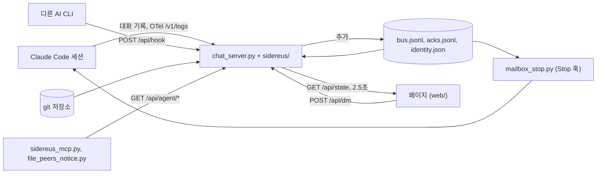
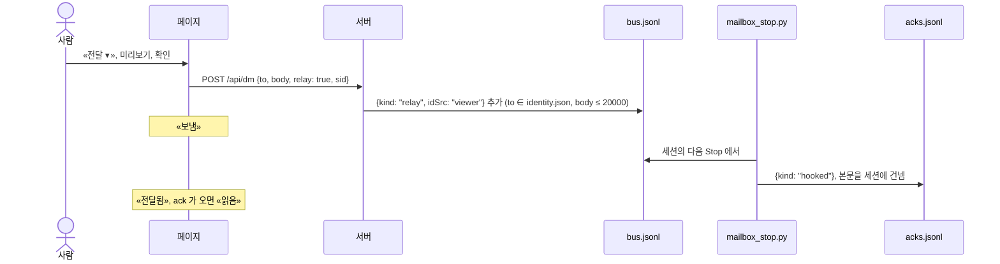

# 구조

[English](ARCHITECTURE.md) · **한국어**

어디를 고치나:

- 화면: `web/` — `index.html` 뼈대와 `js/NN-*.js`, `css/NN-*.css` 를 import 때 한 페이지로 합친다. 고친 뒤 뷰어를 재시작해야 보인다.
- 데이터·서버: `sidereus/<domain>.py`, 진입점은 `chat_server.py`.
- 기능별 담당 파일: [dev/FILEMAP.md](dev/FILEMAP.md).

시데레우스는 AI 코딩 세션을 보는 로컬 뷰어다. 세션과 서브에이전트가 무엇을 하는지 보여 주고, 사람이 쓴 지시를
메일박스로 세션에 전달한다. 실행은 그 세션이 자기 권한으로 한다.
규칙은 `AGENTS.md`, 함정은 `docs/dev/TRAPS.md`(`docs/dev/traps/` 목차), 모듈 순서는 `refactor/STAGE3.md` 에 있다.

설계를 정하는 제약:

- 메타데이터만. 페이지·카드·타임라인·MCP 에는 경로, 세션 id, 모델, Agent 한 줄 `description` 만 싣고 메시지 본문과
  도구 입력은 싣지 않는다. 예외는 클릭해야 열리는 작업 내역 팝업(`sidereus/work.py`) 하나다.
- `127.0.0.1` 에만 묶이고 Python 3.9 표준 라이브러리(`/usr/bin/python3`)만 쓴다. 밖으로 나가는 호출은 선택 사항인
  한도 조회와 보안 점검의 `api.osv.dev` 패키지 조회뿐이다.
- ⚠시데레우스는 세션에 입력하지 않고(pty, `tmux send-keys`, stdin 없음), 세션을 띄우거나 죽이지 않고, git 쓰기 명령을
  실행하지 않고, 스스로 보내지 않는다. 모든 전달은 미리보기와 확인을 거쳐 사람이 누른 것이다.

## 데이터 흐름

코드의 `HOME` 은 사용자 홈이 아니라 데이터 폴더 `~/.mailbox-mcp` 다(`DATA_DIR`, `MAILBOX_DIR` 로 바꿀 수 있다).
`CODE_DIR` 는 저장소 루트다. 둘 다 `sidereus/config.py` 에 있다. 메일박스 프로토콜(`mailbox_*` 도구 9개, `bus.jsonl`,
`identity.json`)은 모든 세션이 함께 쓰고, 시데레우스는 바꾸지 않는다.

## 서버

`chat_server.py` 에는 `Handler` 핵심부(gzip 을 하는 `_send`, 가드, 경로 일치 분기)와 `main()` 만 있다.
라우트는 `sidereus/routes_get.py`(`_GET_ROUTES`, 경로 55개쯤, 그중 페이지 4개), `routes_struct.py`,
`routes_post.py`(`_POST_ROUTES`, 30개쯤)에 있다. 모르는 경로는 404 다.

가드: `_host_ok`(DNS 리바인딩), `_origin_ok`(다른 출처 POST. OTel 과 `/api/hook` 은 건너뜀),
`/api/*` GET 의 `Sec-Fetch-Site: cross-site|same-site` 거부, chunked 본문 거부.

`main()` 은 데몬 스레드 11개(창 학습, 사용량, 한도, 프로젝트 비용, 주간 사용량, 오늘, 실패, 잠자기 방지, 구조·타임라인·도구 색인
예열)와 한도 소진 예열을 띄운다. 각각 `features.thread_on(name)` 이 허락할 때만 시작한다. `--demo` 는 스레드
없이 가짜 세계를 띄우고 실제 파일은 읽지 않는다.

기능(`features/<id>.json`, `sidereus/features.py`, `docs/dev/FEATURES.md`)은 자기 모듈, 라우트, 스레드, 상태 키, 웹 파일을
적어 둔다. 끄면 라우트는 404 `{"error":"feature off"}`, 스레드는 시작 안 함, 상태 키는 빠진다. 모듈과 웹 파일은 그대로
불러오므로 `PAGE` 는 켜고 끔과 상관없이 같다.

### state()

`sidereus/state.py` 가 `/api/state` 본문을 조각으로 만든다. 외부 공개용 안정 투영은 `sidereus/state_v1.py` 다.

- 선택 조각은 `_piece(key, fn, default)` 를 거친다. 예외가 나면 기본값과 가벼운 경고를 낸다.
  ⚠핵심 조각(메일박스 묶음, sessions, cards, cardsRead)은 감싸지 않는다. 빈 기본값을 내면 오류 대신 틀린 화면이 나간다.
- `_lock` 은 메일박스 묶음만 잡는다. 느린 조각(`sessions()`, `cards()`, `usage()`)은 잠금 밖에서 돈다.
  ★2026-09-07: `sessions()` 동안 잠금을 쥐면 쓰기 경로가 0.880초 기다렸다.
- `_state_body` 는 `(since, ncards)` 별로 1초 재사용하고, 다시 만드는 데 오래 걸리면 이전 본문을 20초까지 낸다.
- `since` 가 있으면 그보다 새 메시지만 보낸다. 첫 로드는 오래된 메시지 본문을 비워 보낸다(`bus.MSG_FIRST`).
  ★`since=0` 전체 본문은 3.7 MB 였다.
- `PAGE_BUILD` 가 페이지 자신의 값과 다르면 새로고침 띠가 뜬다. 무거운 탭은 열릴 때 자기 라우트를 따로 부른다.

### 모듈

`sidereus/` 에 모듈이 135개쯤 있다. 낮은 쪽부터의 순서와 정확한 개수는 `refactor/STAGE3.md` 에 있다.

- 모듈은 앞선 모듈만 import 한다. `tests/test_arch.py` 가 순서, 목록, 개수를 검사한다. `chat_server.py` 는 쓰는 것만
  같은 순서로 import 한다.
- `demo*` 모듈은 순서 밖이다(`--demo` 일 때만 늦게 불러옴). `structure_lang_*` 플러그인은 순서에 있지만 이름으로
  import 하지 않고 `structure_plug.plug_load()` 가 불러온다([EXTENDING](EXTENDING.ko.md)).
- ⚠전역 이름마다 주인 모듈이 하나다. import 한 이름에 다시 대입하지 말고 주인 모듈에서 바꾼다. 함께 쓰는 컨테이너는
  제자리에서 고친다.
- ⚠테스트는 그 이름을 읽는 모듈에서 패치한다(`sidereus.live_probe._av_cache`). `chat_server` 에서 하지 않는다.

## 전달

- 단계는 페이지가 `relayStat(sid)`(`web/js/88b-board.js`)에서 계산한다.
- ⚠`hooked` 나 `ack` 만 넘겨준 것으로 친다. 감시기의 `delivered` 는 알림만 간 것이다.
- ⚠프롬프트에서 쉬는 세션은 깨울 수 없다. 다음 턴이 끝날 때 도착한다.
- 훅 규칙: [HOOKS](HOOKS.ko.md#claude-code-stop-훅).

터미널 앞으로 가져오기(`POST /api/term/focus`, `sidereus/term.py`)는 서버 자신의 행에서 얻은 tty 를 고정된 `osascript`
에 인자로 넘긴다. 실패하면 페이지가 `claude --resume <sid>` 를 복사한다.
⚠앞으로 가져오기만 한다. tty 를 스크립트 문자열에 끼워 넣지 않고 아무것도 입력하지 않는다.

## 웹

`web/index.html` 에는 표시가 세 개 있다. `@@INCLUDE app-head.js@@`, `@@INCLUDE css/*.css@@`, `@@INCLUDE js/*.js@@`.
`sidereus/page.py` 의 `_load_page()` 가 import 때 이를 바꿔 넣는데, glob 은 이름순으로 이어 붙이므로 `NN-` 이 곧 불러오는
순서다. 결과는 인라인 `PAGE` 하나이고 `PAGE_BUILD` 는 그 sha256 앞 12자리다. JS 는 모두 한 범위를 함께 쓴다.
파일 지도: `docs/dev/FILEMAP.md`.

- ⚠`web/` 은 import 때 한 번 읽는다. 바꾼 것을 보려면 다시 시작한다.
- ⚠JS 는 최상위 문장 경계에서만 나눈다(파일마다 `node --check` 통과). 구분자 없이 이어 붙이므로 끝 줄바꿈 하나도
  `PAGE` 를 바꾼다.

## 저장 파일

데이터 폴더 아래에 있고, 원자적 교체(임시 파일 + `os.replace`)로 쓴다. 경로 상수는 주인 모듈에 있다.

| 파일 | 주인 | 내용 |
|---|---|---|
| `bus.jsonl` | 메일박스 MCP, `bus` | 메일박스 글 전부, 추가만 |
| `acks.jsonl` | 메일박스 MCP, 감시기, `mailbox_stop.py` | 전달·읽음 기록 |
| `identity.json` | 메일박스 MCP(`mailbox_login`) | cwd → id. DM 을 보낼 수 있는 유일한 대상 |
| `rooms.json`, `profiles.json` | 메일박스 MCP, `routes_post` | 방, 참여자, 초대 |
| `room-admin.json`, `room-tags.json` | `room_admin`, `room_tags` | 숨긴 방(보기에서만), 방 해시태그 |
| `cards.jsonl`, `review-state.json` | `cards`, `review` | 작업 카드, «검토함» 표시 |
| `config.local.json` | `prefs`, `cc_settings` | 설정([CONFIG](CONFIG.ko.md)) |
| `quota-*`, `usage-*`, `otel-*.json` | `quota`, `usage_index`, `usage`, `otel` | 한도, 토큰, OTel 집계 |
| `win-model.json`, `compact-win.json` | `live_win`, `burn_scan` | 학습한 컨텍스트 창, 압축 창 |
| `ext-sessions.json`, `ext-runs.json` | `ext_store` | 외부 CLI 행, 하위 실행 |
| `.stop-hook/<sid>.json`, `plmark/<sid>.json` | `mailbox_stop.py`, `pl_mark.py` | 훅 커서, 파이프라인 표시 |
| `viewer.log`, `viewer.err` | launchd | stdout, stderr. 추가만 |

## 게이트

| 게이트 | 검사 |
|---|---|
| `scripts/check.sh --fast` | `/usr/bin/python3` py_compile, `node --check`, `bash -n`, 파이프라인 JSON, PAGE 조립, 유출 검사. pre-commit 훅도 이것 |
| `scripts/check.sh --full` | + `tests/run.sh`, `screen_check.mjs` |
| `tests/test_arch.py` | 계층, STAGE3, 전역 주인, 크기 상한, 안전, 조용한 오류, JS 전역, 메타데이터만, 기능 정의 |

- 크기 상한: `sidereus/*.py` 620줄, `web/js/*.js` 700줄, Python 함수 130줄. 이미 넘은 것은 `tests/arch_baseline.json` 에
  묶여 있다. ⚠고칠 때는 기준을 줄이고, 통과시키려고 늘리지 않는다.
- ⚠컴파일은 `/usr/bin/python3`(3.9)로 한다. launchd 가 그것으로 돌리고, 다른 인터프리터로는 새 문법이 빠져나간다.
- 화면 검사는 `--demo` 를 임시 포트의 헤드리스 Chrome 에서 돌린다. ⚠실제 뷰어는 건드리지 않는다. 기준 갱신
  (`--update`)은 오케스트레이터가 정한다.
- ⚠테스트는 `tests/_load.py` 로 `chat_server.py` 를 불러오고(스레드 없음) 실제 파일, 시계, 네트워크를 쓰지 않는다.
- ⚠`/api/*` 만이 아니라 그려진 화면에서 확인한다. API 는 맞는데 화면이 틀린 적이 있다.

## 확장

| 추가할 것 | 할 일 |
|---|---|
| 상태 조각 | 주인 모듈에 함수 + `state()` 에 `_piece(...)` 한 줄. 메타데이터만 |
| 라우트 | `_g_*` + `_GET_ROUTES`, 또는 `_p_*` + `_POST_ROUTES`. 본문은 `_body_json(cap, …)` 으로 제한 |
| 모듈 | `refactor/STAGE3.md` 에 자리와 개수 |
| 웹 조각 | `web/js/NN-name.js` 나 `web/css/NN-name.css` |

어댑터·언어·파이프라인: [EXTENDING](EXTENDING.ko.md). 훅(표준 라이브러리. ⚠어떤 오류든 빈 출력으로 0 종료): [HOOKS](HOOKS.ko.md). MCP 도구: [MCP](MCP.ko.md).

적용: 게이트, 다시 시작, 실제 화면 확인, `bash backup.sh`. 새 함정은 `docs/dev/traps/<domain>.md` 에 적는다(목차: `docs/dev/TRAPS.md`).
