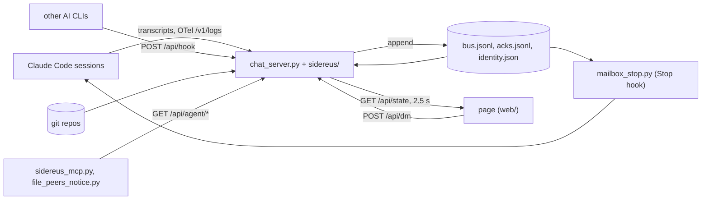
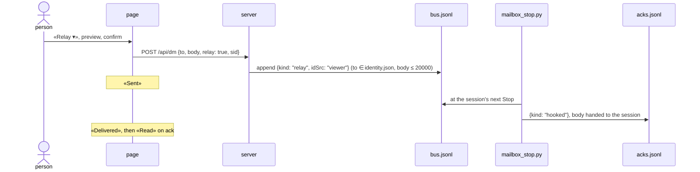

# Architecture

**English** · [Korean](ARCHITECTURE.ko.md)

Where to change things:

- Screen: `web/` — `index.html` skeleton plus `js/NN-*.js` and `css/NN-*.css`, assembled into one page at import; restart the viewer to see a change.
- Data and server: `sidereus/<domain>.py`; the entry point is `chat_server.py`.
- Which file owns which feature: [dev/FILEMAP.md](dev/FILEMAP.md).

Sidereus is a local viewer for AI coding sessions. It shows what each session and subagent is doing and relays a
person's instructions to a session through the mailbox; the session runs them with its own permissions.
Rules: `AGENTS.md`. Traps: `docs/dev/TRAPS.md` (index of `docs/dev/traps/`). Module order: `refactor/STAGE3.md`.

Constraints that shape the design:

- Metadata only. Pages, cards, timeline and MCP carry path, session id, model and the one-line Agent `description`,
  never message bodies or tool input. The one exception is the work log (`sidereus/work.py`), opened by a click.
- `127.0.0.1` only, Python 3.9 stdlib (`/usr/bin/python3`), no packages. Outbound calls: the optional
  quota lookup and the security checks' package lookups at `api.osv.dev`.
- ⚠Sidereus never types into a session (no pty, `tmux send-keys`, stdin), never spawns or kills one, never runs git
  write commands, and never sends on its own: every relay is a click after a preview and a confirm.

## Data flow

`HOME` in the code is the data folder `~/.mailbox-mcp` (`DATA_DIR`, overridable with `MAILBOX_DIR`), not the user's
home. `CODE_DIR` is the repo root. Both are in `sidereus/config.py`. The mailbox protocol (nine `mailbox_*` tools,
`bus.jsonl`, `identity.json`) is shared with every session and Sidereus does not change it.

## Server

`chat_server.py` holds the `Handler` core (`_send` with gzip, guards, exact-path dispatch) and `main()`.
Routes are in `sidereus/routes_get.py` (`_GET_ROUTES`, about 55 paths, 4 of them pages), `routes_struct.py` and
`routes_post.py` (`_POST_ROUTES`, about 30). Unknown paths get 404.

Guards: `_host_ok` (DNS rebinding), `_origin_ok` (cross-origin POST; skipped for OTel and `/api/hook`),
`Sec-Fetch-Site: cross-site|same-site` refused on `/api/*` GET, chunked bodies refused.

`main()` starts eleven daemon threads (window learning, usage, quota, project cost, weekly usage, today, failures,
keep-awake, structure, timeline and tool-index warm-up) and the quota-burn warm-up, each gated by `features.thread_on(name)`.
`--demo` serves a synthetic world with no threads and reads nothing real.

Features (`features/<id>.json`, `sidereus/features.py`, `docs/dev/FEATURES.md`) list their modules, routes, threads,
state keys and web files. Off means routes return 404 `{"error":"feature off"}`, threads do not start and state keys
are omitted. Modules and web files still load, so `PAGE` is identical for any toggle state.

### state()

`sidereus/state.py` builds the `/api/state` body from pieces; `sidereus/state_v1.py` is the stable public projection.

- Optional pieces go through `_piece(key, fn, default)`: an exception gives the default and a soft warning.
  ⚠The core pieces (mailbox bundle, sessions, cards, cardsRead) are not wrapped; an empty default would show a
  wrong screen instead of an error.
- `_lock` covers only the mailbox bundle. Slow pieces (`sessions()`, `cards()`, `usage()`) run outside it.
  ★2026-09-07: holding it through `sessions()` made the write path wait 0.880 s.
- `_state_body` caches per `(since, ncards)` for 1 s and serves the old body up to 20 s during a slow rebuild.
- With `since`, only newer messages are sent; the first load stubs older bodies (`bus.MSG_FIRST`).
  ★The full `since=0` body was 3.7 MB.
- A `PAGE_BUILD` different from the page's own shows a refresh banner. Heavy tabs fetch their own route when opened.

### Modules

About 135 modules in `sidereus/`, listed low to high in `refactor/STAGE3.md` with the exact count.

- A module imports only earlier ones. `tests/test_arch.py` checks order, listing and count. `chat_server.py` imports
  only what it uses, in the same order.
- `demo*` modules sit outside the order (lazy, `--demo` only). `structure_lang_*` plug-ins are in the order but loaded
  by `structure_plug.plug_load()`, never by name ([EXTENDING](EXTENDING.md)).
- ⚠Each global has one owning module. Never rebind an imported name; change it in the owner. Shared containers are
  mutated in place.
- ⚠Tests patch the module that reads a name (`sidereus.live_probe._av_cache`), not `chat_server`.

## Relay

- The page derives the stage in `relayStat(sid)` (`web/js/88b-board.js`).
- ⚠Only `hooked` or `ack` counts as handed over; a watcher's `delivered` only notified.
- ⚠A session idle at its prompt cannot be woken. The relay arrives when its next turn ends.
- Hook rules: [HOOKS](HOOKS.md#claude-code-stop-hook).

Terminal focus (`POST /api/term/focus`, `sidereus/term.py`) passes the tty, taken from the server's own rows, as an
argument to a fixed `osascript`. If that fails the page copies `claude --resume <sid>`.
⚠Focus only: the tty is never formatted into script text and nothing is typed.

## Web

`web/index.html` has three markers, `@@INCLUDE app-head.js@@`, `@@INCLUDE css/*.css@@`, `@@INCLUDE js/*.js@@`.
`sidereus/page.py` `_load_page()` replaces them at import, joining globbed files in name order, so `NN-` is the load
order. The result is one inline `PAGE`; `PAGE_BUILD` is the first 12 hex digits of its sha256. All JS shares one
scope. File map: `docs/dev/FILEMAP.md`.

- ⚠`web/` is read once at import; restart to see a change.
- ⚠Split JS only at top-level statement boundaries (each file passes `node --check` alone). Files are joined with no
  separator, so a trailing newline changes `PAGE`.

## Stores

In the data folder, written atomically (temp file + `os.replace`). The owner module holds the path constant.

| File | Owner | Holds |
|---|---|---|
| `bus.jsonl` | mailbox MCP, `bus` | every mailbox post, append-only |
| `acks.jsonl` | mailbox MCP, watcher, `mailbox_stop.py` | delivery and read receipts |
| `identity.json` | mailbox MCP (`mailbox_login`) | cwd → id; the only valid DM targets |
| `rooms.json`, `profiles.json` | mailbox MCP, `routes_post` | rooms, members, invites |
| `room-admin.json`, `room-tags.json` | `room_admin`, `room_tags` | hidden rooms (view only), room hashtags |
| `cards.jsonl`, `review-state.json` | `cards`, `review` | task cards, «reviewed» marks |
| `config.local.json` | `prefs`, `cc_settings` | settings ([CONFIG](CONFIG.md)) |
| `quota-*`, `usage-*`, `otel-*.json` | `quota`, `usage_index`, `usage`, `otel` | quota, token and OTel tallies |
| `win-model.json`, `compact-win.json` | `live_win`, `burn_scan` | learned context and compaction windows |
| `ext-sessions.json`, `ext-runs.json` | `ext_store` | external CLI rows, child runs |
| `.stop-hook/<sid>.json`, `plmark/<sid>.json` | `mailbox_stop.py`, `pl_mark.py` | hook cursors, pipeline marks |
| `viewer.log`, `viewer.err` | launchd | stdout, stderr, append-only |

## Gates

| Gate | Checks |
|---|---|
| `scripts/check.sh --fast` | py_compile with `/usr/bin/python3`, `node --check`, `bash -n`, pipeline JSON, PAGE assembly, leak scan; also the pre-commit hook |
| `scripts/check.sh --full` | + `tests/run.sh`, `screen_check.mjs` |
| `tests/test_arch.py` | layering, STAGE3, global ownership, size caps, safety, silent errors, JS globals, metadata only, feature manifests |

- Size caps: `sidereus/*.py` 620 lines, `web/js/*.js` 700, a Python function 130. Old violations are frozen in
  `tests/arch_baseline.json`. ⚠Shrink the baseline when fixing; never grow it to pass.
- ⚠Compile with `/usr/bin/python3` (3.9); launchd runs it, and another interpreter lets newer syntax through.
- The screen check runs `--demo` in headless Chrome on a temporary port. ⚠It never touches the live viewer. Its
  baseline (`--update`) is the orchestrator's call.
- ⚠Tests load `chat_server.py` via `tests/_load.py` (no threads) and never read live files, the clock or the network.
- ⚠Verify on the rendered page, not only `/api/*`. The API has been right while the screen was wrong.

## Extending

| To add | Do |
|---|---|
| state piece | function in the owner module + one `_piece(...)` line in `state()`; metadata only |
| route | `_g_*` + `_GET_ROUTES`, or `_p_*` + `_POST_ROUTES`; bound the body with `_body_json(cap, …)` |
| module | a place and the count in `refactor/STAGE3.md` |
| web part | `web/js/NN-name.js` or `web/css/NN-name.css` |

Adapters, languages, pipelines: [EXTENDING](EXTENDING.md). Hooks (stdlib; ⚠exit 0 with empty output on any error): [HOOKS](HOOKS.md). MCP tools: [MCP](MCP.md).

Apply: gates, restart, check the live page, `bash backup.sh`. New traps go in `docs/dev/traps/<domain>.md` (index: `docs/dev/TRAPS.md`).
