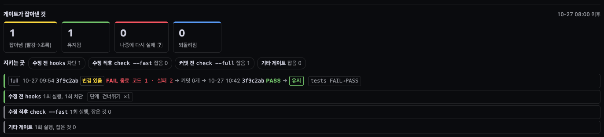

# 사용 가이드

[English](GUIDE.md) · **한국어**

설치는 [GETTING-STARTED.ko.md](GETTING-STARTED.ko.md) 를 먼저 본다. 스크린숏은 `python3 -m sidereus start --demo` 의 합성 데이터다.
뷰어는 파이프라인 탭으로 열린다(파이프라인 기능을 끄면 타임라인, 저장된 탭이나 탭 순서가 있으면 그쪽). 화면 언어는 브라우저를 따르고(`en*` 이면 영어, 아니면 한국어) 설정 › «화면 언어» 로 바꾼다.
열린 탭은 주소에 남는다(`/#pipelines`, `/#structure`, `/#timeline`, `/#chat` …). 그 주소로 열면 그 탭이 열리고, 창마다 탭을 따로 기억하며 주소 없이 연 새 창은 마지막에 고른 탭으로 열린다. Chrome 주소창의 «앱 설치» 로 뷰어를 별도 창 앱처럼 쓸 수 있다.

배치: 왼쪽 사이드바(로고, «주의» 목록, 화면 목록, 알림과 설정). 기본은 아이콘 줄이고 토글이나 Cmd/Ctrl+B 로 넓힌다(기억됨). 1200px 이상이면 본문을 밀고, 좁으면 본문 위에 겹친다.
오른쪽은 상단 바 한 줄(화면 제목, 실행 중 세션, «나를 기다림» 칩, 세션 서랍), 본문, 맨 아래 상태 표시줄 순이다.

⚠ 화면에는 메타데이터(경로, 세션 id, 모델, 한 줄 작업)만 나온다. 대화 내용은 작업 내역을 눌렀을 때만 보인다.

## 파이프라인 실행 지켜보기

파이프라인 탭은 프로젝트의 단계(`.claude/pipelines/*.json`)를 보여 주고, 단계마다 그 에이전트가 도는 동안 불을 켠다.

### 지금 작업 중 (왼쪽 목록)
- 살아 있는 세션이 타임라인과 같은 이름 칸(로고·프로젝트·상태)으로 나오고, 실행 요약이 한 줄 붙는다: «● 작업 중 · <단계>», «● 응답 필요 · <단계>»(주황), «● 유휴 · <단계>»(회색: 실행은 열려 있고 턴은 끝남), «✓ <이름> 완료». 실행이 없으면 «파이프라인 없음 · <분류>» 나 «미선언» 이 붙는다.
- 세션을 누르면 오른쪽에 그 실행이 열린다. 작업 중인 실행을 보고 있지 않을 때 실행이 작업을 시작하면(새로 고침 직후에는 가장 최근의 작업 중 실행이) 저절로 열리고, 보던 실행이 끝나거나 멈추면 가장 최근의 작업 중 실행으로 넘어간다.
- 세션 아래에는 서브에이전트가 타임라인처럼 나온다(로고·종류·한 줄 작업·실행 점). 실행 중인 것이 먼저, 조용한 것은 흐리게, 6개까지 보이고 나머지는 «+N 더 보기». 누르면 그 실행이 열리고 에이전트의 단계가 선택된다(태그가 있을 때).
- «‹» 로 접으면 상태 점 줄이 된다(점을 누르면 펼치고 그 세션을 연다). 가장자리를 끌어 폭을 바꾸고, 폭은 기억된다.

### 보기 화면
세 칸이 위아래로 놓인다: 캔버스 | 고른 단계의 결과 | «실행 중 N» 카드.
- 단계를 누르면 선택된다. 고른 단계가 없으면 실행 중인 단계, 없으면 마지막으로 끝난 단계를 보여 주고, 실행이 없으면 비어 있다.
- 고른 단계가 실행 중이었다면, 실행이 하나만 돌고 있는 동안 선택이 다음으로 실행되는 단계로 옮겨 간다.
- 결과 창에는 단계의 결과, 되돌림(↺), 에이전트 수와 경과 시간, 게이트 증거(없으면 «이 단계의 게이트 증거가 아직 없습니다»)와 게이트 명령(없으면 «게이트 명령 없음 — 이 단계는 기계가 채점하지 않습니다»)이 나온다. 에이전트 버튼을 누르면 그 작업 내역이 열린다.
- «실행 중 N» 은 열린 실행을 모두 보여 준다(프로젝트·파이프라인·단계 칩·에이전트 수). 줄을 누르면 그 실행이 열린다. 실행이 없어도 «실행 중인 파이프라인 없음» 으로 자리를 지켜서, 실행이 시작·종료돼도 화면이 움직이지 않는다.
- 칸 사이 손잡이를 끌어 크기를 바꾸고, 두 번 누르면 기본값(남는 높이의 캔버스 75%, 결과 14%, 카드 11%)이다. 크기는 비율로 기억돼 창 크기를 바꿔도 비율이 유지된다.
- 머리줄에는 선택 상자, 실행 막대, «✎ 편집», «▶ 실행» 이 있다.

### 프로젝트·파이프라인 고르기
- «프로젝트»: 작업 중·최근·전체에서 찾고, 맨 아래 «+ 프로젝트 불러오기». 폴더 선택 창 맨 위 «최근 세션 폴더» 에 최근 14일 안에 세션이 일한 폴더가 최대 8개 뜨고, 누른 뒤 «이 폴더 추가» 로 넣는다. «파이프라인»: 이 프로젝트의 파이프라인(⚠ = 스키마 오류, • = 저장 안 한 수정, 점 = 실행 중). 파일의 `use` 한 줄(«언제 쓰나»)은 보기·편집 모두 머리 줄 아래와 고르기 목록 툴팁에 뜬다.
- «+ 새로 만들기 ▾»: «+ 새 파이프라인», «다른 프로젝트에서 가져오기», «AI 에게 초안 요청», «템플릿으로 시작». «+ 새 파이프라인» 은 Claude 세션을 한 번 연 폴더에만 생긴다(파일은 그 폴더 `.claude/` 에 저장).
- 파이프라인이 없는 프로젝트는 «AI 에게 초안 요청» 과 «템플릿으로 시작» 이 먼저 보인다. 빠른 템플릿은 «빠른 템플릿 ▾» 안에 접혀 있고, «적용» 은 파이프라인이 하나 생긴 뒤에 나타난다. 하나를 고르고 미리보기를 본 뒤 «확인 — 만들기» 를 눌러야 `.claude/pipelines/<name>.json` 이 생긴다.
- «교차 리뷰 (Codex)» 는 단계 하나짜리 템플릿이다: 세션이 자기 권한으로 `git diff` 를 읽기 전용 `codex exec` 로 한 번 리뷰하고, Codex 계정으로 청구된다. 한 번에 끝나 이어서 지시할 수 없고, Codex 가 설치·로그인돼 있어야 한다. Sidereus 는 Codex 를 실행하지 않는다.
- «적용»(편집에서, «자동 · 매번 묻기 · 끄기»)은 이 프로젝트의 새 세션이 파이프라인을 쓰는 방식을 정한다.

### 단계가 켜지는 방식
- Agent description 이 `[pl:<파이프라인>/<단계 제목>]` 으로 시작하면 그 단계가 켜진다. 태그된 실행이 없는 단계는 대기로 남는다. 태그는 세션이 알아서 붙이도록 안내받는다.
- 파이프라인 밖 작업은 `[pl-none:<분류>]` 로 선언한다. 파이프라인 파일이 있는 프로젝트에서 열린 실행도 선언도 없이 처음 수정·커밋하면 파이프라인 이름과 함께 한 번 막힌다.
- 태그와 파일 형식: [EXTENDING.ko.md](EXTENDING.ko.md).

### 실행 요청하기
1. «▶ 실행» 을 누른다(저장 안 한 수정이 있으면 잠긴다: 먼저 저장).
2. «실행 요청 보내기» 에서 방식(«세션 직접 실행 (기본)» 또는 «Workflow»; Codex 세션에는 Workflow 가 없다), 세션(메일박스에 로그인한 세션만), 한 줄 요청, 필요하면 «이번 실행만 모델 바꾸기» 를 고른다.
3. «보낼 메시지» 를 확인하고 «확인 — 보내기». 버튼이 흐리면 툴팁에 빠진 것이 나온다.
- 파이프라인은 세션이 자기 권한으로 돌린다. Sidereus 는 아무것도 실행하지 않는다. Codex 세션은 지금 또는 다음 턴이 끝날 때 요청을 받는다.

### 편집
- «✎ 편집» 을 누르면 «편집 중 <이름>» 띠 아래 팔레트(«단계 카탈로그»), 고칠 수 있는 캔버스, 단계 편집기가 나온다. 게이트 수·«평가»·«적용» 은 여기에 있다.
- 단계 이름은 단계 패널 맨 위에서 바꾼다. «정렬»·«화면에 맞추기» 로 캔버스를 정리한다. «단계 카탈로그» 는 «+ 추가» 를 누르거나 캔버스로 끌어 놓는다. ✓ 항목은 게이트 명령을 함께 넣는다.
- 고친 것이 없으면 «닫기» 나 Esc 로 보기로 돌아간다. 고친 것이 있으면 «취소» 는 변경을 버리고(파일은 그대로), «저장»(미리보기 + 확인)은 저장한 뒤 돌아간다.
- 저장 안 한 수정은 보기로 가도 남는다(• 표시, «저장 안 된 변경 — 편집에서 저장하세요»). 페이지를 새로 고치면 사라진다. 마지막 모드는 기억된다.
- 새 파이프라인은 편집으로 열린다. 다른 프로젝트에서 빌려 온 파이프라인은 보기만 된다.
- 초안(템플릿·AI 초안·«+ 새로 만들기»)에는 «초안 — 아직 저장 안 됨» 띠가 뜬다: «✓ 이 초안 저장» 을 눌러야 파일이 생기고, «취소» 나 Esc 는 쓰지 않고 닫는다.

⚠ 저장 안 한 수정이 있으면 Esc 는 아무것도 하지 않고, 메뉴나 실행 패널이 열려 있으면 Esc 가 초안을 닫지 않는다 — 키 하나로 작업이 사라지지 않는다.

### 다른 실행
- Workflow 도구로 돌린 실행은 보기 전용 «Workflow» 묶음에 나온다.
- 다른 프로젝트에 정의된 파이프라인은 여기서 실행 중일 때만 머리줄 끝 «<이름> · <프로젝트>에서» 칩(`arch-map` 은 «Sidereus 내장»)으로 나오고, 누르면 보기 전용 캔버스가 열린다.

### 하네스 리포트: 작업이 제대로 나왔나
같은 탭의 «하네스 리포트»(기본으로 켜져 있고, «환경설정» › «기능» 에서 끌 수 있다).

- «런타임 최신 패치 뒤처짐»(맨 위, 최신 보안 점검 리포트 기준): 런타임마다 현재 → 같은 버전대 최신 패치(보안 수정 · 지원 종료), 최신 릴리스보다 몇 버전대 뒤인지, 다음 할 일 한 줄(예: `brew upgrade node@<버전대>` 뒤 뷰어 재시작). «최신 모름» 은 깨끗한 결과가 아니다. 7일 넘은 리포트는 «지금도 최신인지는 다시 실행해야 압니다», 리포트가 없으면 «점검 기록 없음» 과 실행 명령을 보여 준다. 모두 최신 패치면 조용한 한 줄. python.org 는 보안 표시가 없어 Python 은 지원 종료와 패치로만 판단한다.
- 맨 위 숫자 넷: «잡아냄 (빨강→초록)»(게이트가 실패한 뒤 같은 게이트의 다음 실행이 통과), «유지됨», «다시 깨짐»(이후 다시 실패했거나 고친 커밋이 되돌려짐 — 어느 쪽인지는 카드에 나온다), «사람이 먼저 찾음»(버그 수정 파이프라인, 즉 파일에 `"catch": "person"` 이 있는 파이프라인의 끝난 실행 수).
- «지키는 곳» 은 지점별 수를 보여 준다 — «수정 전»(훅, «차단 n») · «수정 직후»(`check --fast`) · «커밋 전»(`check --full`) · «사람»(버그 수정 파이프라인이 있을 때만). 누르면 그 지점 카드만 남는다.
- «푸시 후 (CI)»(`gh run watch`)는 증거 훅이 `gh run watch <id> --exit-status`(또는 `gh run view … --exit-status`) 결과를 기록하면 나타난다. 빨강 CI 실행을 뒤의 초록 실행이 고치면 다른 사건처럼 카드 하나가 된다. «유지: CI 연속 통과 n/5» 는 최근부터 이어진 초록 CI 실행 수이고, 빨강이 나오면 처음부터 다시 센다. Sidereus 는 `gh` 나 GitHub 를 직접 호출하지 않는다.
- «사람» 카드: 파이프라인 이름, 실행이 끝난 시각, 그 실행에서 만든 커밋, 그 커밋이 건드린 `tests/` 파일(«이제 이것을 지키는 테스트»). 없으면 «지키는 테스트 없음», git 을 읽지 못하면 «커밋을 읽지 못함».
- 잡은 건마다 카드 하나, 최신이 위: 빨강 실행(시각 · 해시 · 종료 코드 · 실패 수) → 고친 커밋 → 초록 실행 → 유지/되돌림. 돌았지만 잡은 게 없는 지점은 조용한 카드 하나 «n회 실행, 잡은 것 0».
- 카드 아래 «점검 결과» 는 문제가 있는 구성 줄 수다. «문제»·«확인 필요» 를 누르면 도구 › «구성 지도» 에서 하나씩 옮겨 간다.
- «다음 할 일»(접힘, 표시된 구성 줄 · «다시 고침»/«되돌려짐»/«미검증 (미커밋)» 카드 · «필수 게이트 건너뛰기» 칩 아래): «뜻», «왜 중요한가», «누가 하나»(직접 · AI 세션에 맡김 · 주인 결정), «다음 할 일» 을 한 줄씩 보여 준다(`docs/verdicts/<id>.md`). «직접» 은 명령 하나나 설정 위치(예: `/hooks`), «주인 결정» 은 «무시해도 되는 때» 가 붙는다. «AI 세션에 맡김» 은 «지시 초안» 으로 보낼 글(판정 id · 파일 · 수만, 대화 내용 없음 · 프로젝트에 맞는 파이프라인이 있으면 `sidereus-bugfix` 처럼 이름을 넣음)을 미리 보고, 세션을 골라 «확인 — 보내기» 를 누르면 메일박스로 전달된다. Sidereus 는 직접 고치지 않는다.
- «읽는 법»(접힘)은 숫자 넷, «지키는 곳», 사건 카드를 한 줄씩 설명한다. «게이트 실행 기록»(접힘)에 실행 줄 원본이 있다.
- «가드 자가 점검»(접힘)은 Sidereus 저장소의 고정 재현 세트를 다시 돌린 결과다. 가드마다 잡아야 할 경우와 통과시켜야 할 대조 경우를 «넣은 상황 · 기대 · 실제 · PASS/FAIL» 로 보이고, 옆에 고른 프로젝트의 실제 수(«차단 n» · «잡음 n» · «유지 n · 되돌림 n»)를 둔다. Sidereus 는 직접 돌리지 않는다 — `python3 scripts/harness_selfcheck.py` 를 실행한다. 실행 전엔 «아직 실행 안 함», 다른 커밋의 결과면 «다른 커밋» 표시가 붙는다.
- 켜진 단계 카드에는 최근 게이트 실행이 붙는다: «게이트 PASS · 테스트 N · 화면 a/b», 실패면 빨간 «게이트 FAIL». «게이트 FAIL» 을 누르면 하네스 리포트로 넘어가 그 실행의 사건 카드를 보여 준다(아직 안 고쳤으면 그렇다는 한 줄, «파이프라인» 으로 돌아오면 보던 파이프라인과 스크롤 그대로). 게이트가 없는 단계는 주황 «검증 없음», «게이트 n/m» 은 기계가 채점하는 단계 수다. 설계·리뷰는 검증 없음이 정상이다.
- «가드»(아무것도 안 고른 단계 패널): `git commit` 전에 통과할 게이트와 «되돌림 한도»([HOOKS.ko.md](HOOKS.ko.md#가드-hookspl_guardpy-claude-code-만)).
- «평가»: 단계별 심은 결함 적중률, red 확인, 불안정 여부([dev/PIPELINE.md](dev/PIPELINE.md#evaluation-seeds-red-check-flaky-gates)). «개선 제안»: «직접 고치기» 는 편집기를 채우고, «AI 에게 요청» 은 요청을 미리 보여 준다.
  - 용어: «잡음» = 일부러 심은 결함(시드) 중 단계 게이트가 잡은 비율 · «red 확인» = 일부러 망가뜨린 사본에 게이트를 한 번 돌려 실패한 기록, 결함을 잡을 수 있다는 증거 · «홀드아웃» = 조정에 쓰지 않고 남겨 둔 심은 결함, 점수가 과적합되지 않았는지 확인하는 데만 쓴다. 머리글에 마우스를 올리면 같은 설명이 뜬다.
- «상세» › «결과»: 기록된 점검 실행, 최신순([`ev_hook.py`](HOOKS.ko.md#ev_hookpy) 를 넣으면 어느 프로젝트의 테스트·빌드·린트 명령도).

⚠ Claude Code 텔레메트리가 없으면 출력을 남기지 않는 훅은 기록이 없다. «기록 없음» 은 «안 돌았음» 이 아니다. 텔레메트리가 켜져 있으면 Claude Code 훅은 전체 실행 횟수가 잡히고, 3일 이상 측정했는데 0회면 «N일 동안 한 번도 실행 안 됨» 으로 표시된다.

## 코드 구조 읽기

구조 탭은 «아키텍처»(프로젝트의 모듈 구조도)로 열린다. «프로젝트» 는 파이프라인 탭과 같은 선택기다.

### 구조도 읽기
- 근거가 확인된 연결만 그린다(«검증 N/M»). «모든 연결» 은 추정 연결까지 보인다.
- 띠는 위에서 아래로: 계층형 코드는 계층, 아니면 코드가 도는 자리(진입 · 클라이언트 · 서버 · 저장소). 띠에 마우스를 올리면 뜻이 뜬다.
- 연결을 누르면 근거, 근거를 누르면 코드. 모듈을 누르면 그 모듈과 이웃만 보인다.
- «생성» 뒤에는 구조도를 그린 AI(플랫폼 로고와 모델; 단계마다 다르면 모두, 단계 이름은 툴팁)가 붙는다. 예전 구조도는 «그린 모델: 알 수 없음». ⚠ 가 붙은 주황 «… 생성» 배지는 HEAD 보다 오래됐다는 뜻이다(툴팁에 차이).
- 미니맵(오른쪽 아래): 누르거나 끌어 옮기고, 모서리 버튼으로 숨긴다.

### 만들기·갱신
- «구조도 생성 요청»(없음) / «구조도 업데이트 요청»(코드보다 오래됨) / «다시 그리기»(HEAD 기준) → 미리보기 → «확인 — 보내기» 로 열린 세션에 읽기 전용 `arch-map` 파이프라인을 맡긴다. 도착하면 저절로 그려진다. git clone 으로 받은 Sidereus 에서만 된다. 설치 패키지(pipx/uv)에는 파이프라인을 돌릴 저장소가 없어서 보내기가 꺼지고 그 이유가 나온다.
- 받은 세션(프로젝트 · 세션 · 메일박스 id)과 상태가 한 줄로 남는다: «보냄», «실행 중 · <단계>», «중지 중» → «중지됨» / «완료» / «세션 없음». 새로고침해도 남는다. «중지»(미리보기 + 확인)는 지금 단계만 마치고 더 띄우지 말라고 전한다.

### 흐름

- «흐름» 에는 진입점마다 흐름이 하나씩 있다. ✓ = 모든 단계 증명, 빨간 점선 = 증명 안 된 단계. 화살표를 누르면 그 호출 자리의 코드가 뜬다.

### 주요 문제 (보안)
- «주요 문제 N건» 은 보안 결과 창을 연다(gitleaks·npm audit·osv-scanner·semgrep·bandit·trivy — `security-checks` 파이프라인). 비밀값은 나오지 않는다.
- «보안 점검 실행» 은 로그인한 세션에 `security-checks` 실행 요청을 보내고(미리보기 + 확인), 세션이 없으면 복사할 명령을 보여 준다. 진행은 구조도 요청처럼 보인다. «이미지 포함» 을 켜면 베이스 이미지도 검사한다(`--images`, 사용자의 `docker login` 사용 · [SECURITY.ko.md](../SECURITY.ko.md#컨테이너-이미지-trivy)).
- «개선 요청» 은 고른 문제를 `security-fix` 파이프라인 실행 요청(수정 → 재검사 → 읽기 전용 리뷰)으로 보낸다. 단계는 다른 실행처럼 켜진다. 점검이 HEAD 보다 오래되면 보안 배지에 ⚠ 와 점선 테두리가 붙는다.
- 더 새 점검이 나오면 요청 줄은 «요청 k건: 수정 j · 남음 k−j» 로, 요청한 문제만 센다. «완료» 는 요청한 문제가 모두 사라지고 리뷰 단계가 통과했을 때만이다. 실행 없이 수정 커밋만 있으면 «파이프라인 없이 처리됨». 세션의 답장으로는 바뀌지 않는다.
- 창 머리줄과 배지 툴팁에 마지막 점검 시각(«마지막 점검 MM-DD HH:MM · 3일 전»)이 보이고, 30일이 지나면 주황색이 된다.
- 필터: 심각도(«모든 심각도 / 높음 이상 / 치명만»)와 도구. «규칙 숨기기» 는 «규칙 N개 숨김 · 보이기» 까지 이 저장소에서 그 규칙을 숨긴다. 보기만 바뀌고 파일은 그대로다.
- 창 아래에 점검 이력과 «마지막 보고서»(최근 `security-report-*.md`, 일반 텍스트)가 있다. AI 리뷰 줄에는 «모델 생성 · 검증 안 됨» 이 붙는다. 이슈 목록과 이력 목록 사이 손잡이로 높이를 나눈다(끌기·화살표 키, 두 번 누르기·Home 은 기본값, 크기는 기억).
- 스캐너 결과는 같은 도구가 더 보고하지 않으면 해결로 바뀐다. AI 결과는 `scripts/arch_checks.py --repo <repo> --mark <slug>@<file> resolved|false-positive` 전까지 열려 있다.

### 크기·마크다운
- «크기»: 줄 수 트리맵. «코드» 로 본코드·전체·테스트를, «색» 으로 색 기준을 바꾼다.
- 소스 보기는 프로젝트 안 상대 경로 마크다운 이미지(png·jpg·gif·webp·svg, 5 MB 이하)를 그림으로 보여 준다. 원격·비밀·없는 이미지는 대체 텍스트로 남는다.

구조도를 만들고 검증하는 방식: [STRUCTURE.ko.md](STRUCTURE.ko.md).

## 타임라인에서 증거 보기

타임라인은 판정 뒤의 증거다: 에이전트마다 실제로 무엇을 언제 했나.

1. 세션과 서브에이전트마다 행이 하나다. 마우스를 올리면 작업이 뜬다. «행» › «실행 중만» 은 끝난 서브에이전트를 숨긴다(기억됨). 이름 열 가장자리를 끌어 넓히고 두 번 누르면 기본값. 세션 행의 빨간 선은 압축, 파란 점선은 /clear 다.
2. 파이프라인을 돌리는 세션은 이름 아래 단계 진행 막대가 붙고(초록 완료, 줄무늬 파랑 지금, 주황 되돌림, 빨강 실패), 누르면 파이프라인 탭에서 그 실행이 열린다. 머리의 «실행 N» 은 열린 실행과 막 끝난 실행을 모으고, 테두리는 가장 나쁜 실행 색이다(노랑 «정체»).
3. «변경» 칩은 따라가는 세션에서 «변경 기준»(기본 «미커밋») 대비 바뀐 파일 수다. «⚠ 공유 n개» = 두 세션이 같은 파일을 고쳤다. 누르면 diff: 기준 «미커밋»·«세션 시작 이후»·«main(master) 대비»·«전체», «추적 안 된 파일 포함», 저장소마다 탭.
   추적 안 된 비밀 파일(`.env`, `.example`·`.sample`·`.template` 을 뺀 `.env.*`, `*.pem`, `*.key`, `*.p12`, `*.pfx`, SSH 개인 키, `.netrc`, `.npmrc`, `.pypirc`, `credentials`)은 이름만 보인다. 내용은 읽지도 보내지도 않고 diff 에는 «(contents hidden: secret file)» 이 뜬다.
4. 아래 요약은 «결과»(커밋, 실행 ✓/✕/↺)와 «증거»(게이트 PASS/FAIL, 처음 실패한 단계). «더 보기» 는 기다린 시간·튀는 값·비용을 더한다.
5. 커밋을 누르면 diff, 세션·에이전트를 누르면 작업 내역. 내역 창이 열려 있으면 탭으로 더해지고, Shift+클릭은 새 창이다.
6. 오래된 일은 이력 탭(계정이 둘 이상이면 계정 선택, 다른 계정 Claude 행은 «다른 계정 N개» 로 접힘).

## 나를 기다리는 세션 찾기

1. 사이드바 «주의» 목록을 본다(접혀 있으면 개수 배지). 권한 대기·«답 대기» 세션이 먼저 온다. 답을 기다리는 요청은 답했거나 세션이 끝난 것이 확인될 때까지 남는다.
2. 행마다 한 번에 처리한다: «터미널» 은 그 탭을 앞으로, «답장» 은 한 줄 입력칸(Enter 로 그 세션 메일박스에 보내고 Esc 로 닫음), «완료» 는 그 요청을 숨기고, «나중에» 는 30분 잠재우고, «읽음» 은 에이전트 완료를 읽음으로 한다. 행을 누르면 세션이 열린다.
3. 턴을 마친 세션은 약 15초 뒤 «작업 끝 · 입력 대기» 행으로 뜬다. 끝난 세션·백그라운드 완료와 함께 «기준 아래 N» 에 들어간다.
4. 상단 바의 세션 서랍에 전체 목록이 있다(도구 실행·생각 중·내 답 대기·끝남·멈춤). 행을 누르면 작업 내역이 열리고, 터미널 앱(iTerm2, Terminal.app, Orca)을 설정해 두면 그 탭도 앞으로 온다.

- 권한 대기·답 대기 알림은 어디서 눌러도(카드·토스트·행·OS 알림) 그 세션의 터미널 탭을 띄운다.
- 유휴·git 필터 칩은 누를 때마다 단계가 바뀐다(유휴: 끔, 10, 30, 60분 / git: 끔, ↑ 미푸시, ↑~ 미푸시·더티). 브랜치 칩은 그 세션의 diff 를 연다.
- 훅이 없는 Codex 세션은 «훅 미연결» 과 «마지막 활동 N분 전» 만 보인다([HOOKS.ko.md](HOOKS.ko.md)).

⚠ Orca 는 CLI 를 설치해야(설정 › General) 정확한 탭으로 간다. 없으면 앱만 앞으로 온다.

## 리셋 전에 할당량이 바닥날지 보기

1. 상태 표시줄에 5시간·7일 사용량이 나온다. 누르면(또는 Enter) 계정마다 5시간·7일 남은 비율과 리셋 시각, 열린 세션이 나온다. «할당량 상세» 는 전체 창을 연다. Esc 로 닫는다.
2. «리셋 때 남음» = 리셋 시점의 예상 여유, «100% 도달» = 이 속도로 5시간 한도가 바닥나는 시각. `≈`·`±N%` 는 추정치이고 창이 진행될수록 좁아진다.
3. Claude 계정이 둘 이상이면 색 띠·이름 칩·계정 선택, 마우스를 올리면 «메인으로»([CONFIG](CONFIG.ko.md#claude-계정-여러-개)).

절약 판정은 예측이 경계를 3분 넘게 지나야 바뀐다.

## 두 에이전트가 같은 파일을 고칠 때

1. 알림에 «충돌 위험» 이 뜨면 누른다. 파일과 두 세션이 나온다.
2. 브랜치 탭에서 저장소를 고른다. worktree 카드마다 미커밋 파일과 그 세션이 나온다.
3. 한쪽에 멈추라고 하려면 그 작업 내역의 메시지 칸에 쓴다(미리보기 뒤 메일박스로).

세션이 직접 확인하게 하려면 MCP 도구 `sidereus_file_peers` 를 쓴다([MCP.ko.md](MCP.ko.md)).

## 토큰 쓴 곳 보기

- 토큰 탭: 모델·프로젝트별 사용량, 돌고 있는 서브에이전트, «일별»(날마다 토큰·비용·상위 프로젝트 2개; 오늘 비용엔 실시간분이 빠짐), «비싼 작업 상위 5».
- 도구: 스킬·에이전트·명령·MCP 서버·훅과 30일 사용 횟수. 맨 위 «구성 지도»(접힘, 펼침 상태 기억)는 파이프라인 탭 프로젝트의 훅 흐름·규칙 파일·에이전트 ↔ 파이프라인·MCP 서버·스킬이다. «문제»·«확인 필요» 숫자를 누르면 하나씩 옮겨 간다.
- 인사이트 탭(긴 기간): «도구 순위», «소요 시간», «캐시 재작성», «시간대별 활동»·«모델별»(최근 8일), «훅 비용»(이벤트 종류별, 스크립트 이름은 안 나옴).
- 계정이 둘 이상이면 계정 선택은 기간 집계(토큰)와 OTel 카드(인사이트)만 좁힌다. 실시간 수치는 모든 계정 그대로다.

## 채팅 방 관리

채팅 탭 › 방 목록의 «관리».

1. 숨기기: 방을 체크하고 «선택한 방 숨기기 (N)», «확인». 되돌리기: «숨긴 방 N» › «되돌리기».
2. 만들기: «방 만들기», 이름, 세션 선택, 미리보기 확인, «확인». 초대: 카드의 «초대».

- 숨기기는 보기만 바꾼다. 글은 메일박스에 남는다(숨긴 목록은 `room-admin.json`).
- 로그인한 세션만 고를 수 있고, 초대는 메일박스 DM 으로 간다. «참여자» 에는 살아 있는 세션의 플랫폼 로고가 붙는다.
- «받는 곳» 줄이 Enter 로 갈 곳이다(`# 방` 또는 `DM → 상대`). 빨간 숫자는 안 연 글 수다(이 브라우저에만 기억).

## 처음 둘러보기

짧은 둘러보기가 파이프라인부터 화면을 차례로 짚는다. 꺼 둔 기능의 단계는 건너뛴다. 마지막 단계에 `/plugin marketplace add <경로>` 가 나온다.
«?» 패널이나 설정 › «둘러보기 다시 보기» 로 다시 본다. `?tour=1` 은 강제로 열고 `?tour=0` 은 막는다. 에이전트가 띄운 창에는 «자동 테스트 창» 띠가 붙는다(`?autobar=0` 이면 숨김).

## 설정 바꾸기

설정(톱니)은 묶음마다 탭이 하나다. 화면 값은 뷰어 서버에 저장돼 바로 적용되고, 서버 값(`config.local.json`)은 재시작 뒤 적용된다. 흐린 행은 지금 효과가 없다(마우스를 올리면 이유).

- «화면»: 언어, 배경 톤(기본 «시스템»), 글자 크기, 세션 목록(«서랍» / «오른쪽 고정»), 토큰 위젯, 번다운 곡선, «터미널 연동»(자동 · iTerm2 · Terminal.app · Orca · 끔).
- «알림»: «알림 수준», «같은 세션 반복 묶기 (30분)», «알림 목록에 보일 카드», «세션이 나를 기다리면 알림»(OS 알림, 기본 꺼짐).
- «절약 모드»(`/saver` 와 같은 파일, 모든 세션): «작동 모드», «목표 소진율», «목표 한도 도달 시»(«안내만» · «경고 후 진행» · «차단»), «수준별 동작».
- «타임라인»: 재생 속도, 갱신 주기, 구간, «변경 기준», 서브에이전트 행 작업 설명.
- «환경설정»: «시작 화면», «달 마크», «탭 순서와 숨김»(타임라인은 숨길 수 없음), «메인 계정», «설정 초기화», 서버 값(«내 이름», «기본 방», «고급»: 절약 모드 훅 폴더, «포트»), «자동 압축»·«압축 기준 (토큰)», «기능», «메일박스 감시».
- «진단»(읽기 전용): 같은 이벤트에 걸린 다른 훅, AGENTS.md 를 가리는 CLAUDE.md, 조용히 꺼진 듯한 훅, 설치된 플러그인, «보안 도구».
- «저장된 뷰»(있을 때만): «적용» 으로 그 뷰로 바꾼다.

⚠ «자동 압축»·«압축 기준» 은 계정마다 Claude Code `settings.json` 에 쓰이고(미리보기 + 백업) 새 세션부터 적용된다. «기능» 은 «저장» 하면 재시작 없이 바로 바뀐다.

키 목록: [README.ko.md «설정 바꾸기»](../README.ko.md#설정-바꾸기), [CONFIG.ko.md](CONFIG.ko.md).

## 이상할 때

[GETTING-STARTED.ko.md](GETTING-STARTED.ko.md#이상할-때) 를 본다.
