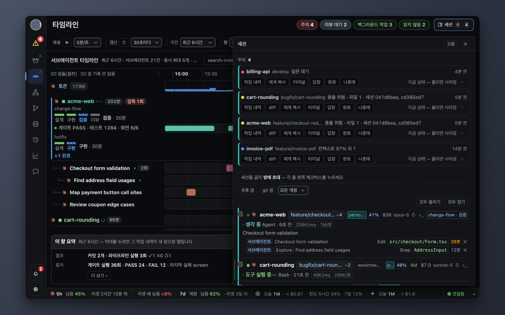
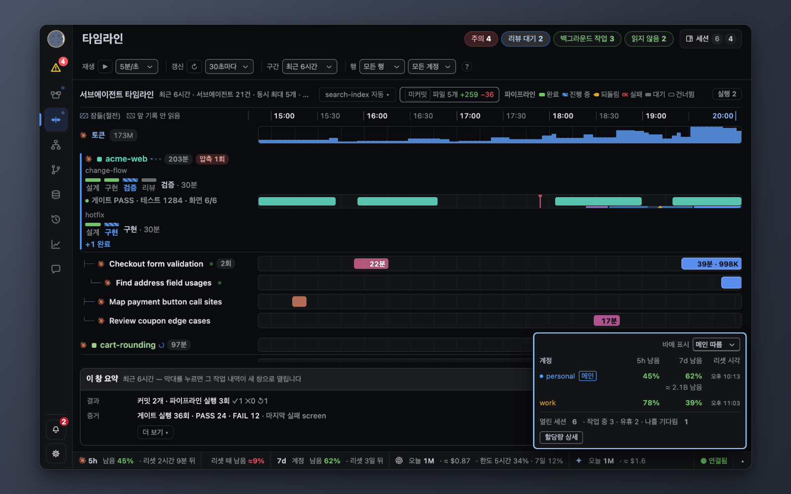
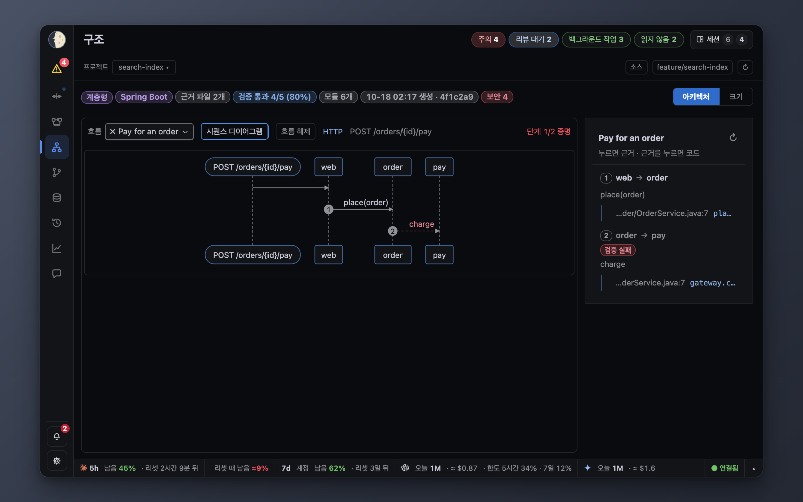
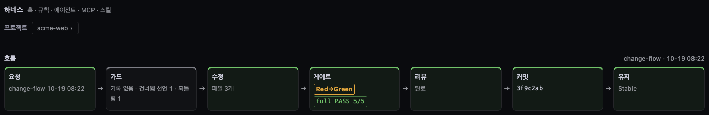

# 사용 가이드

[English](GUIDE.md) · **한국어**

설치는 [GETTING-STARTED.ko.md](GETTING-STARTED.ko.md) 를 먼저 본다. 스크린숏은 `python3 -m sidereus start --demo` 의 합성 데이터다. 데모와 실제 뷰어 모두 파이프라인 탭으로 열린다(파이프라인 기능을 끄면 타임라인).

왼쪽에 사이드바가 있다(로고, «주의» 목록, 화면 목록, 맨 아래 알림과 설정). 기본은 아이콘 줄이고(아이콘에 마우스를 올리거나 포커스하면 이름과 단축키 숫자가 바로 뜬다), 토글이나 Cmd/Ctrl+B 로 넓힌다. 펼침 여부는 기억된다. 창이 넓으면(1200px 이상) 본문을 밀고, 좁으면 본문 위에 겹쳐 열린다.
오른쪽은 위에서부터 한 줄 상단 바(화면 제목, 실행 중 세션, «나를 기다림» 칩, 세션 서랍), 본문 순이다. 상태 표시줄은 화면 맨 아래에 있다.

## 나를 기다리는 세션 찾기

1. 사이드바의 «주의» 목록을 본다(접혀 있으면 개수 배지). 나를 필요로 하는 정도 순으로 놓인다. 답이나 승인을 기다리는 요청은 아무리 오래돼도 남아 있고, 답했거나 세션이 끝난 것이 확인될 때만 빠진다.
   행마다 한 번 눌러 처리한다: «터미널» 은 그 탭을 앞으로, «답장» 은 행 아래 한 줄 입력칸을 연다(받는 세션이 보이고, Enter 로 그 세션 메일박스에 보내며 Esc 로 닫는다). «완료» 는 그 요청 하나만 숨기고(같은 세션의 새 요청은 다시 뜬다), «나중에» 는 30분 잠재운다. «에이전트 완료 미확인» 행의 «읽음» 은 그 완료 알림을 읽음으로 표시한다(그 세션을 열어도 같다). 행 자체를 누르면 예전처럼 세션이 열린다.
2. 전체 목록은 상단 바의 세션 서랍에 있다. 세션마다 도구 실행 중, 생각 중, 내 답 대기, 끝남, 멈춤 중 하나다.
3. 행을 누르면 작업 내역이 열린다. 터미널 앱을 설정해 두면 그 세션의 탭으로도 옮겨 간다.
   지원: iTerm2, Terminal.app, Orca (Orca 는 설정 › General 에서 CLI 를 설치해야 정확한 탭으로 간다. 없으면 앱만 앞으로 온다).
4. 나를 기다리는 알림(권한 대기·답 대기)을 누르면 — 알림 패널 카드, 토스트, «주의» 행이나 알약, OS 알림 어디서든 — 그 세션의 터미널 탭이 앞으로 온다. 탭에 닿을 수 없으면 원래 동작대로다.

- «입력 대기» 세션에 감시(Monitor)가 떠 있으면 옆에 흐린 «· 감시 N» 이 붙는다. 상태는 그대로 내 차례다.
- 끝났거나 백그라운드 작업만 끝난 세션은 맨 끝 «기준 아래 N» 으로 접힌다.
- 훅이 없는 Codex 세션은 기록 파일에서 읽어 «훅 미연결» 칩이 붙고 «마지막 활동 N분 전» 만 보인다(훅 설정: [HOOKS.ko.md](HOOKS.ko.md)).
- «유휴 끔»·«git 끔» 칩은 누를 때마다 단계가 바뀌고 지금 단계를 보여 준다. 유휴: 끔, 10, 30, 60분. git: 끔, 미푸시 ↑, 미푸시·더티 ↑~.
- 브랜치 칩은 git 상태(`~N`)를 보여 주고, 누르면 그 세션의 diff 가 열린다.
- 서브에이전트 행에는 작업 설명이 나온다. general-purpose 가 아닌 에이전트에만 종류 칩이 붙는다.
- «최근 끝난 세션» 행에는 세션 id 앞 8자리와 마지막 서브에이전트 작업이 붙는다.

## 리셋 전에 할당량이 바닥날지 보기

1. 화면 맨 아래 상태 표시줄에 5시간·7일 사용량이 나온다.
   누르면(또는 Enter) 레이어가 열린다: 로그인한 계정마다 5시간·7일 남은 비율과 리셋 시각(메인 계정 표시), 열린 세션(작업 중 / 유휴). 거기서 «할당량 상세» 를 누르면 전체 할당량 창이 열린다. Esc 나 바깥 클릭으로 닫힌다. 메인 계정 줄에는 «메인» 표시가 붙고, 다른 계정 줄에 마우스를 올리면 «메인으로» 가 보이며 누르면 그 계정이 메인 계정이 된다(설정 › 메인 계정과 같은 값).
   
2. «리셋 때 남음» 은 리셋 시점의 예상 여유, «100% 도달» 은 이 속도로 5시간 한도가 바닥나는 시각이다.
3. Claude 계정이 둘 이상이면 줄마다 계정 색 띠와 이름 칩이 붙고, 계정 선택으로 화면 하나씩 좁힐 수 있다([CONFIG](CONFIG.ko.md#claude-계정-여러-개)). 세션에서 고른 계정은 «지금 봐야 할 세션»·«최근 끝난 세션» 에도 적용된다.

`≈` 와 `±N%` 는 추정치 표시다. 창이 진행될수록 좁아진다.
상태바의 절약 판정은 예측이 경계를 3분 넘게 지나야 바뀐다.

## 세션이 한 일 되짚기

1. 타임라인 탭을 연다. 세션과 서브에이전트마다 행이 하나다. 마우스를 올리면 작업 설명이 뜬다. 도구줄의 «행» 을 «실행 중만» 으로 바꾸면 끝난 서브에이전트 행이 숨는다. 세션 행은 그대로 남는다(브라우저에 기억). 시간 축 줄의 이름 칸 오른쪽 끝을 끌면 이름 열이 넓어진다(두 번 누르면 기본값). 세션 행의 빨간 선은 압축, 파란 점선은 /clear 자리다(마우스를 올리면 시각과 새 세션·이전 세션 id 가 나온다).
2. 타임라인 머리 줄 오른쪽의 «변경» 칩(«[기준] 파일 N개 +a −d» 로 보이고, «변경» 이라는 이름은 툴팁에 있다)이 따라가는 세션에서 «변경 기준» 대비 바뀐 파일 수를 보여 준다(기본 «미커밋»: 작업 트리와 인덱스를 직전 커밋과 비교, 툴팁에 기준이 나온다. 칩 앞쪽의 작은 배지가 실제로 쓴 기준을 보여 주고, 고른 기준을 쓸 수 없으면 경고 색으로 바뀐다)(세션이 둘 이상이면 옆의 «세션» 검색 콤보박스로 하나를 고르거나 «자동(최근 활동)» 을 둔다). «⚠ 공유 n개» 는 두 세션이 같은 파일을 고쳤다는 뜻이다. 칩을 누르면 같은 기준으로 diff 창이 열린다. 기준 버튼은 «미커밋»(직전 커밋) · «세션 시작 이후» · «main(master) 대비» · «전체»(원격)이고, 추적 안 된 파일은 «추적 안 된 파일 포함» 을 켜야 보인다. 세션이 여러 저장소에 걸치면 저장소 탭으로 하나를 고른다.
   아래 서랍의 요약은 기본으로 결과(커밋, 파이프라인 실행 ✓/✕/↺)와 증거(게이트 PASS/FAIL, 처음 실패한 단계)를 보여 준다. «더 보기» 를 누르면 나를 기다린 시간·튀는 값·비용(토큰, 커밋당 토큰)이 더 나오고, 펼친 상태는 기억된다.
3. 커밋 행을 누르면 diff, 세션을 누르면 작업 내역이 열린다.
4. 더 오래된 일은 이력 탭에서 세션을 펼친다. 계정이 둘 이상이면 도구 줄에 계정 선택(«모든 계정» / 계정 하나)이 붙는다. 다른 계정의 Claude 행은 «다른 계정 N개» 한 줄로 접히고, 외부 CLI 행은 남으며, 날짜 머리는 보이는 행만 센다.

파이프라인을 돌리는 세션은 이름 아래에 단계별 진행 막대가 붙고(초록 완료, 줄무늬 파랑 지금 단계, 주황 되돌림, 빨강 실패), 누르면 파이프라인 보기에서 그 실행이 열린다.

타임라인 머리의 «실행 N» 칩은 모든 세션의 열린 실행과 막 끝난 실행을 모아 보여 주고, 테두리는 가장 나쁜 실행의 색을 따른다(단계가 멈춘 듯하면 노랑 «정체»).

⚠ 화면에는 메타데이터만 나온다. 다른 세션의 대화는 작업 내역을 눌렀을 때만 보인다.

작업 내역 창이 열려 있으면 다른 세션·에이전트를 눌러도 그 창에 탭으로 더해진다. 새 창으로 열려면 Shift+클릭. 인사이트 실패 행처럼 지난 시점으로 여는 기록은 늘 따로 창이 뜬다.

## 두 에이전트가 같은 파일을 고칠 때

1. 알림에 «충돌 위험» 이 뜨면 누른다. 파일과 두 세션이 나온다.
2. 브랜치 탭은 파이프라인·구조와 같은 검색 콤보박스로 저장소를 고른다. worktree 카드마다 미커밋 파일과 그 세션이 나온다. 커밋 행 칩은 커밋을 만든 세션과 비용이다.
3. 한쪽에 멈추라고 하려면 작업 내역의 메시지 칸에 쓴다. 미리보기를 확인하면 메일박스로 간다.

세션이 직접 확인하게 하려면 MCP 도구 `sidereus_file_peers` 를 쓴다. [MCP.ko.md](MCP.ko.md) 참고.

## 토큰 쓴 곳 보기

1. 토큰 탭에 모델별·프로젝트별 사용량과 돌고 있는 서브에이전트가 나온다.
   - 추세 그래프 아래 «일별» 표는 고른 기간의 날마다(최근 날 먼저) 토큰·비용·상위 프로젝트 2개를 보여 준다. 오늘 토큰에는 실시간분이 들어가고 비용에는 빠진다.
   - 계정이 둘 이상이면 계정 선택이 «기간 집계» 묶음(일별 표, 추세, 구성, 모델, 프로젝트)만 좁힌다. 오늘 막대·도넛·소진·에이전트 비용·실시간 수치는 모든 계정 그대로다 — 그 출처(OTel, 소진)에는 파일별 계정이 없다.
2. «비싼 작업 상위 5» 는 오늘 또는 이번 주 가장 많이 쓴 서브에이전트 실행이다(작업, 종류, 소요 시간).
3. 더 긴 기간은 «인사이트» 탭에서 본다.
   - 계정이 둘 이상이면 «도구 순위» 위의 계정 선택이 OTel 카드(도구 순위, 소요 시간, 캐시 재작성, 시간대별 활동, 모델별, 훅 비용)만 좁힌다. 실패·주간 요약·커밋당 토큰은 모든 계정 그대로다. 계정별 수집을 시작하기 전의 OTel 기록은 «모든 계정» 에만 잡힌다.
   - «소요 시간» 은 도구를 총 시간(호출 수 × 평균) 순으로 보여 주고, 그중 실패한 호출에 쓴 비율을 붙인다. 기간은 «도구 순위» 와 같다.
   - «캐시 재작성» 은 날마다 캐시 토큰 중 읽지 않고 새로 만든 비율과, 그 비율이 높은 세션을 보여 준다.
   - «시간대별 활동» 은 요일 × 시간 칸에 OTel API 요청 수를 색으로 보여 준다(현지 시각). 칸에 마우스를 올리면 요청·토큰 수가 나온다. 최근 8일까지만 담긴다.
   - «모델별» 은 모델마다 토큰·비중·요청 수를 보여 주고(예: Opus 5.5, 전체 id 는 마우스를 올리면 나온다), 막대를 메인·서브에이전트·부가 호출로 나눈다. 같은 8일 제한이 있다.
   - «훅 비용» 은 훅 이벤트 종류(예: PreToolUse)를 총 시간 순으로 보여 주고, 실행 수·한 번 발생당 평균 시간·실패 수를 붙인다. 개별 훅 스크립트 이름은 나오지 않는다.

## 코드 구조 보기

구조 탭은 «아키텍처» 로 열린다. 프로젝트의 모듈 구조도다.

- 머리의 «프로젝트» 는 파이프라인 탭과 같은 검색 선택기다. 버튼에는 이름, 그 프로젝트에서 파이프라인이 돌면 점, 불러오는 중이면 «…» 가 뜨고, 마우스를 올리면 경로와 세션이 보인다.

### 구조도 읽기
- 띠는 위에서 아래로 놓인다: 계층형 구조는 계층을, 기능·앱 단위 구조는 코드가 도는 자리(진입 · 클라이언트 · 서버 · 저장소)를 보여 준다. 띠에 마우스를 올리면 뜻이 뜬다.
- 연결을 누르면 근거, 근거를 누르면 코드가 뜬다. 모듈을 누르면 그 모듈과 이웃만 보인다.
- ⚠ 가 붙은 주황 «… 생성» 배지는 구조도가 지금 커밋보다 이전 것이라는 뜻이다. 툴팁에 HEAD 가 얼마나 앞섰는지 뜬다.
- «생성» 뒤 배지는 구조도를 그린 AI 다: 플랫폼 로고와 모델(단계마다 모델이 다르면 모델을 모두 표시하고, 단계 이름은 툴팁). Sidereus 가 실행한 세션에서 기록한다. 예전 구조도는 «그린 모델: 알 수 없음» 으로 뜬다.

### 구조도 만들기·갱신
- 요청 버튼 → 미리보기 → «확인 — 보내기» 로 열린 세션에 `arch-map` 파이프라인을 맡긴다(읽기 전용). 구조도가 오면 저절로 그려진다.
- 버튼은 «구조도 생성 요청»(아직 없음) · «구조도 업데이트 요청»(코드보다 오래됨) · «다시 그리기»(HEAD 기준) 중 하나로 뜬다. 실행도 확인도 같다.
- 구조도 요청을 보내면 받은 세션(프로젝트 · 세션 · 메일박스 id)과 상태가 한 줄로 남는다: «보냄» · «실행 중 · <단계>» · «중지 중» → «중지됨» / «완료» / «세션 없음». 새로고침해도 유지된다. 실행 중엔 «중지» → 미리보기 → «확인 — 보내기» 로 그 세션에 지금 단계만 마치고 다음 단계를 띄우지 말라고 전한다.

### 흐름 보기

- «흐름» 에는 진입점마다 흐름이 하나씩 있다. ✓ 는 모든 단계가 증명됐다는 뜻이고, 빨간 점선은 증명되지 않은 단계다.
- 화살표를 누르면 그 호출 자리의 코드가 뜬다.

### 미니맵
- 오른쪽 아래에 있다. 누르거나 끌면 구조도가 그 자리로 가고, 모서리 버튼으로 숨기거나 편다.

### 주요 문제
- «주요 문제 N건» 을 누르면 보안 문제 창이 열린다(gitleaks·npm audit·osv-scanner·semgrep·bandit — `security-checks` 파이프라인). 비밀값은 나오지 않는다.
- 그 창의 «보안 점검 실행» 은 프로젝트의 메일함 로그인 세션에 `security-checks` 실행 요청을 보낸다(미리보기 + 확인). 그런 세션이 없으면 터미널에서 실행할 명령을 복사하게 보여 준다. 실행 중에는 구조도 요청과 같이 현재 단계와 경과 시간이 보이고, 세션이 끊기거나 멈추면 그 줄이 사라지고 요청 줄에 «세션 없음» 이 뜬다. 의존성 결과는 GHSA 규칙 옆에 CVE 번호도 보인다.
- «개선 요청» 은 고른 문제를 세션에 보내고, 수정이 커밋되면 `arch-map` 을 다시 돌려 달라고 함께 요청한다.
- 항목마다 등급(치명·높음·중간·낮음)이 붙고, 머리줄에 등급별 개수가 나온다. 필터로 목록을 좁힌다: «모든 심각도 / 높음 이상 / 치명만» 과 도구 필터(«모든 도구» · gitleaks·semgrep·bandit·osv-scanner·npm-audit). 항목의 «규칙 숨기기» 는 그 규칙을 이 저장소에서 숨기고, 새 점검 뒤에도 «규칙 N개 숨김 · 보이기» 를 누를 때까지 숨긴 채로 둔다. 탭 배지는 숨기지 않은 규칙만 센다(툴팁에 숨긴 개수). 보기만 바뀐다 — `checks-security.json`·`security-log.jsonl`·보고서는 그대로이고, 오탐 표시는 여전히 `scripts/arch_checks.py --mark … false-positive` 로 한다.
- 창 아래에는 점검 이력이 나온다(보기 전용). «마지막 보안 점검» 경과 시간, 열린 문제, 해결된 문제(날짜 · 커밋), 오탐 순이다. AI 리뷰에서 나온 줄에는 «모델 생성 · 검증 안 됨» 이 붙는다.
- «마지막 보고서» (보안 점검이 보고서를 남긴 뒤에 나온다) 는 가장 최근 `security-report-*.md` 를 별도 창에 일반 텍스트로 연다.
- 스캐너 결과는 같은 도구의 다음 점검에서 사라지면 해결로 바뀐다. AI 리뷰 결과는 표시할 때까지 열려 있다: `scripts/arch_checks.py --repo <repo> --mark <slug>@<file> resolved|false-positive`.

### 크기
- 줄 수 트리맵이다. «코드» 로 본코드·전체·테스트를, «색» 으로 색 기준을 바꾼다.

### 마크다운 미리보기
- 소스 보기에서 프로젝트 안의 상대 경로 이미지(png·jpg·gif·webp·svg, 5 MB 이하)는 그림으로 보인다. 원격·비밀·없는 이미지는 대체 텍스트로 남는다.

구조도를 만들고 검증하는 방식, 트리맵 지원 언어: [STRUCTURE.ko.md](STRUCTURE.ko.md).

## 채팅 방 관리

방 카드 이름 옆 빨간 숫자는 그 방에서 아직 안 연 남의 글 수다. 방을 열면 사라진다(이 브라우저에만 기억).

채팅 탭에서 방 목록의 «관리» 를 누른다. 방 카드에 체크박스, «초대», «숨기기» 가 붙는다. DM 카드에는 없다.

1. 숨기기: 방을 체크하고(«전체 선택» 은 전부) «선택한 방 숨기기 (N)», «확인». 한 방이면 카드의 «숨기기».
2. 되돌리기: «숨긴 방 N» 에서 «되돌리기». 점은 숨긴 뒤 새 글이 왔다는 뜻이다.
3. 만들기: «방 만들기» 에서 이름을 넣고 세션을 고른 뒤 미리보기 줄을 보고 «확인». 세션을 안 고른 방은 누가 들어올 때까지 빈 카드로 보인다.
4. 초대: 카드의 «초대» 에서 세션을 고르고 «확인».

- 숨기기는 보기만 바꾼다. 글은 메일박스에 남고, 숨긴 목록은 `room-admin.json` 에 있다.
- 로그인한 세션만 고를 수 있다(신원 확정, 또는 읽는 쪽이 있는 Codex 런처 id). 초대는 메일박스 DM 으로 간다.
- 입력창 위 «받는 곳» 줄이 Enter 로 갈 곳이다. 방이면 `# 방`, DM 에 답장하면 `DM → 상대`.
  «방 밖 글» 에서 답장이 아닌 새 글은 기본 방으로 간다(`# 방 (기본 방)`, 설정 `default_room`).
- 글 머리의 점선 칩은 스레드 이름이다.
- 방 목록에서 검색하면 모든 방에서 맞는 글이 나온다. «← 방 목록» 이 검색을 지운다. «+ 저장» 은 고른 것이 있을 때만 보인다.

## 파이프라인 진행 보기

«파이프라인» 탭에 프로젝트의 단계(`.claude/pipelines/*.json`)가 나온다. 단계는 그 에이전트가 도는 동안 켜진다.

### 보기와 편집
- 탭은 «보기» 로 열린다: «지금 작업 중» 목록, 캔버스(단계를 누르면 선택), 그 아래 선택한 단계의 결과와 게이트 근거. 고른 단계가 없으면 실행 중인 단계, 없으면 마지막으로 끝난 단계가 나오고, 실행이 없으면 비어 있다.
- «보기» 의 머리줄에는 선택 상자, 실행 막대, «✎ 편집», «▶ 실행» 이 있다.
- «✎ 편집» 을 누르면 «편집» 으로 바뀐다: «편집 중 <이름>» 띠 아래 팔레트, 고칠 수 있는 캔버스, 단계 편집기(목록 없음). «적용»·게이트 수·평가는 여기에만 있다. «완료» 를 누르면 «보기» 로 돌아간다. 마지막 모드는 기억된다.
- 저장하지 않은 수정은 «보기» 에서도 남는다: 파이프라인에 • 표시가 남고 «보기» 에 «저장 안 된 변경 — 편집에서 저장하세요» 이 뜬다. 페이지를 새로 고치면 사라진다.
- 새 파이프라인은 «편집» 으로 열린다. 다른 프로젝트에서 빌려 온 파이프라인은 보기만 된다.
- 초안(템플릿·AI 초안·«+ 새로 만들기»)에는 «초안 — 아직 저장 안 됨» 띠가 뜬다: «✓ 이 초안 저장» 을 눌러야 파일이 생기고, «← 이전» 이나 Esc 는 쓰지 않고 닫는다.

### 지금 작업 중
- 왼쪽 목록에 살아 있는 세션이 타임라인과 같은 이름 칸(로고·프로젝트·상태)으로 나오고, 실행 요약이 한 줄 붙는다: «● 작업 중 · <단계>», «● 응답 필요 · <단계>»(주황), «✓ <이름> 완료».
- «● 유휴 · <단계>»(회색) = 실행은 열려 있지만 세션이 지금 일하지 않는다(턴이 끝남).
- 세션을 누르면 오른쪽에 그 파이프라인 실행이 열린다. 단계마다의 에이전트는 캔버스에 나온다.
- 목록은 접으면 상태 점 줄이 된다(점을 누르면 펼치고 그 세션을 연다). 가장자리를 끌어 폭을 바꾸며, 폭은 기억된다.

### 프로젝트 고르기
- 한 줄에 «프로젝트»(전체 이름, 누르면 작업 중·최근·전체에서 찾고 맨 아래 «+ 프로젝트 불러오기»), «파이프라인»(같은 찾기 목록, 이 프로젝트 파이프라인만; ⚠ = 스키마 오류, • = 저장 안 한 수정, 점 = 실행 중), «+ 새로 만들기 ▾» 가 있다.
- «+ 새로 만들기 ▾» 안에 «+ 새 파이프라인», «다른 프로젝트에서 가져오기», «AI 에게 초안 요청», «표준 템플릿» 이 있다.
- Claude 세션을 한 번 연 폴더에만 «+ 새 파이프라인» 이 생긴다(파이프라인은 그 폴더 `.claude/` 에 저장된다).
- 파이프라인이 없는 프로젝트에는 «템플릿으로 시작» 버튼이 뜬다: 하나를 누르면 미리보기, «확인 — 만들기» 를 눌러야 `.claude/pipelines/<name>.json` 이 생긴다. 같은 줄에 «AI 에게 초안 요청»·«표준 템플릿» 도 있다.
- «교차 리뷰 (Codex)» 는 단계 하나짜리 템플릿이다: 세션이 자기 권한으로 `git diff` 를 읽기 전용 `codex exec` 로 한 번 리뷰한다(Sidereus 는 Codex 를 실행하지 않는다). 이 단계는 Codex 계정으로 청구되고 나머지 단계는 Claude 그대로다. 한 번에 끝나는 실행이라 이어서 지시할 수 없다. Codex 가 설치돼 있고 로그인돼 있어야 한다.
- «적용»(«자동 · 매번 묻기 · 끄기»)은 이 프로젝트에서 새 세션이 파이프라인을 쓰는 방식을 정한다.

### 단계가 켜지는 방식
- Agent description 이 `[pl:<pipeline>/<단계 제목>]` 으로 시작하면 태그 있는 실행이다. 태그는 세션이 알아서 붙이도록 안내받는다.
- 태그된 실행이 없는 단계는 대기로 남는다.

### 편집
- 단계 이름은 캔버스 아래 단계 패널 맨 위에서 바꾸고 «저장» → 미리보기 → «확인» 으로 기록한다. «정렬», «화면에 맞추기» 로 캔버스를 정리한다.
- «AI 에게 초안 요청» 은 열린 세션에 파이프라인 파일을 써 달라고 보낸다.

### 다른 실행
- Workflow 도구로 돌린 실행은 보기 전용 «Workflow» 묶음에 나온다.
- 다른 프로젝트에 정의된 파이프라인은 여기서 실행 중일 때만 머리 줄 끝에 «<이름> · <프로젝트>에서»(`arch-map` 은 «Sidereus 내장») 칩으로 나온다. 누르면 보기 전용 캔버스와 실행이 열린다.

태그와 파이프라인 파일: [EXTENDING.ko.md](EXTENDING.ko.md).

### 하네스 보는 법

같은 탭의 «하네스» 는 «작업이 제대로 나왔나» 에 답한다.

- «흐름» 은 파이프라인 실행 하나를 상자 일곱 개로 보여 준다: 요청 → 가드 → 수정 → 게이트 → 리뷰 → 커밋 → 유지. 위 칩으로 최근 실행을 고르고, 상자를 누르면 그 기록이 펼쳐진다.
- 게이트는 단계별 PASS/FAIL 을, FAIL 이 PASS 로 바뀌었으면 Red→Green 을 보여 준다. 유지는 마지막 커밋의 PASS 가 유지됐는지다.
- 가드는 파이프라인 훅이 막은 이동을 «차단 n» 으로 보여 주고, 기록 전 실행은 «기록 없음» 이다.

- «상세» › «결과» 는 기록된 점검 실행을 최신순으로 보여 준다. [`ev_hook.py`](HOOKS.ko.md#ev_hookpy) 훅을 넣으면 어느 프로젝트의 테스트·빌드·린트 명령도 들어간다.
- 켜진 단계 카드에는 가장 최근 게이트 실행이 붙는다: «게이트 PASS · 테스트 N · 화면 a/b», 실패면 빨간 «게이트 FAIL».
- 게이트 명령이 없는 단계에는 주황 «검증 없음» 알약이 붙고, 제목 옆 «게이트 n/m» 은 기계가 채점하는 단계 수다. 설계·리뷰는 검증 없음이 정상이다.
- «단계 카탈로그»(창 너비 1600px 이상이면 캔버스 왼쪽, 그보다 좁으면 캔버스 아래 왼쪽): «+ 추가» 를 누르거나 항목을 캔버스로 끌어 놓는다. ✓ 항목은 게이트 명령을 함께 넣는다.
- «가드»(아무것도 안 고른 단계 패널): `git commit` 전에 통과해야 할 게이트와 «되돌림 한도» 를 정한다([HOOKS.ko.md](HOOKS.ko.md#가드-hookspl_guardpy-claude-code-만)).
- 파이프라인 제목의 «평가»: 단계별 심은 결함 적중률, red 확인, 불안정 여부([dev/PIPELINE.md](dev/PIPELINE.md#evaluation-seeds-red-check-flaky-gates)).
- 그 아래 «개선 제안»: «직접 고치기» 는 편집기에 값을 채우고, «AI 에게 요청» 은 세션에 보낼 요청을 미리 보여 준다.
- «구성 지도»(접힘): 훅·규칙 파일·에이전트·MCP·스킬. «점검 결과» 줄이 «문제»·«확인 필요» 를 세고, 숫자를 누르면 하나씩 옮겨 간다.
- 출력을 남기지 않는 훅은 기록이 없다. 그래서 «기록 없음» 은 «안 돌았음» 이 아니다.

## 처음 둘러보기

처음 열면 짧은 둘러보기가 화면 요소를 차례로 짚는다. 중심은 파이프라인이다: 단계별 에이전트·모델, 실행 요청, 진행 표시. 꺼 둔 기능의 단계는 건너뛴다. 마지막 단계에 이 저장소를 플러그인으로 넣는 명령(`/plugin marketplace add <경로>`)이 나온다.

- 다시 보기: «?» 단축키 패널, 또는 설정 › «둘러보기 다시 보기».
- 주소에 `?tour=1` 이면 강제로 연다. `?tour=0` 이면 열지 않는다.
- 에이전트가 띄운 창(playwright, 헤드리스 점검)에는 맨 위에 «자동 테스트 창» 띠가 작게 나온다. 내 탭에는 나오지 않는다. `?autobar=0` 이면 숨긴다.

## 설정 바꾸기

설정(톱니)은 묶음마다 탭이 하나이고 아래 순서다. 머리의 «둘러보기 다시 보기» 는 처음 둘러보기를 다시 시작한다.

- 화면 값은 뷰어 서버에 저장돼 모든 브라우저가 같이 쓰고 바로 적용된다. 서버 쪽 값(`config.local.json`)은 뷰어를 재시작해야 적용된다.
- 지금 효과가 없는 행은 흐리게 잠긴다. 마우스를 올리면 이유가 나온다(예: «작동 모드가 «자동» 일 때만 쓰입니다.»).

«화면»
- «화면 언어»: 한국어 또는 English, 새로고침 없이 바뀐다.
- «배경 톤»: 블랙 · 그레이 · 블루 · 화이트 · «시스템»(기본, OS 의 라이트/다크를 바로 따른다).
- «글자 크기»: 90 / 100 / 110 / 125 %, 글자만 바뀌고 배치와 너비는 그대로다.
- «세션 목록»: «서랍»(위쪽 «세션» 버튼으로 연다) 또는 «오른쪽 고정».
- «오른쪽에 토큰 위젯 보기»: 주간 도넛, 일별, 오늘 프로젝트별, 실시간 차트를 세션 목록 아래에 둔다. 끄면 토큰 탭으로 옮겨 간다.
- «번다운 곡선»: «곡선 보기» 또는 «접기».
- «터미널 연동»: 자동 · iTerm2 · Terminal.app · Orca · 끔. «터미널» 버튼이 앞으로 가져올 대상을 고른다.

«알림»
- «알림 수준»: «중요만»(질문, 중단, 실패) · «전부» · «사용자 지정»(종류마다 «배지» · «목록만» · «숨김»).
- «같은 세션 반복 묶기 (30분)»: 30분 안의 같은 경로·종류는 한 번만 센다.
- «알림 목록에 보일 카드»: «이력 전체» 또는 «읽지 않은 것만».
- «세션이 나를 기다리면 알림»: OS 알림, 기본 꺼짐. «탭이 보일 때도 알림» 은 탭이 보이는 경우까지 더한다.

«절약 모드»(`/saver` 와 같은 파일, 모든 세션에 적용)
- «작동 모드»: «자동 · 목표 시각 · 켜기 1-4 · 끄기». «목표 시각» 을 고르면 HH:MM 칸과 «적용» 이 나온다.
- «목표 소진율»: 자동 모드가 리셋까지 쓰려는 5시간 한도의 비율 — «목표 없음» · 50 · 80 · 100 % 또는 직접 입력. 자동 모드에서만 쓰인다.
- «목표 한도 도달 시»: «안내만» · «경고 후 진행»(첫 프롬프트를 막고, 10분 안에 같은 프롬프트를 다시 보내면 통과) · «차단»(프롬프트와 도구 실행).
- «수준별 동작»(접힘): 수준마다 동시 상한과 더해지는 규칙, 지금 수준을 강조한다. 절약 훅이 표를 보낼 때만 보인다.

«타임라인»
- «재생 속도», «갱신 주기», «구간».
- «변경 기준»: «변경» 칩이 무엇과 비교해 세는지 — «미커밋»(기본) · «푸시 안 함» · «세션 시작 이후» · «기본 브랜치 이후» · «자동»(원격이 있으면 기본 브랜치).
- «서브에이전트 행에 작업 설명 표시»: 한 줄 작업 설명으로 이름을 달고 유형은 칩으로 둔다. 끄면 유형만 보인다.

«환경설정»
- «시작 화면»: «마지막으로 본 탭»(기본) 또는 탭 하나.
- «달 마크»: «한 시간 주기»(기본)는 사이드바 마크가 한 시간에 삭망 주기를 한 바퀴 돌고, «실제 위상» 은 오늘의 달을 보여 준다. 툴팁은 늘 실제 달이다.
- «탭 순서와 숨김»: 위쪽 탭의 순서를 바꾸거나 숨긴다. 타임라인은 숨길 수 없다.
- «메인 계정»: Claude 계정이 둘 이상일 때만 나온다.
- «설정 초기화»: 화면 설정을 백업 폴더로 옮기고 다시 읽는다. 메모 초안과 알림 권한은 남는다.
- 서버: «내 이름», «기본 방». «절약 모드 훅 폴더», «자동 압축 이력»(읽기 전용), «포트» 는 «고급» 안에 있다. «기본값» 으로 항목을 되돌린다.
- «자동 압축» 과 «압축 기준 (토큰)»: 계정마다 Claude Code `settings.json` 에 쓰고 새 세션부터 적용된다. «계정별» 은 계정마다 따로 정하고, «바뀐 계정에 적용» 은 바뀐 계정만 쓴다.
- «기능»: 기능을 끈다(그 탭, 요청, 백그라운드 작업이 멈춘다). «저장» 후 재시작한다.
- «메일박스 감시»: «새 세션이 메일박스 감시를 자동으로 켬», 프로젝트마다 덮어쓸 수 있다. 바꾼 뒤 시작한 세션부터 적용된다.

«진단»(읽기 전용, «갱신» 만; `diag` 기능을 끄면 숨는다)
- Sidereus 와 같은 이벤트에 걸린 다른 훅, AGENTS.md 를 가리는 CLAUDE.md, 조용히 꺼진 것으로 보이는 훅(정적 추정), 설치된 플러그인의 버전과 계정.
- «보안 도구»: 보안 점검이 쓰는 스캐너 — 설치 여부와 버전, 없으면 설치 명령과 «복사». 아무것도 실행하지 않는다.

«저장된 뷰»(하나라도 있을 때만): «적용» 은 그 뷰로 바꾸고 설정을 닫는다.

키 목록: [README.ko.md «설정 바꾸기»](../README.ko.md#설정-바꾸기), [CONFIG.ko.md](CONFIG.ko.md).

## 이상할 때

[GETTING-STARTED.ko.md](GETTING-STARTED.ko.md#이상할-때) 를 본다.
