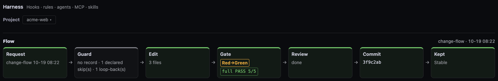

# User guide

**English** · [Korean](GUIDE.ko.md)

Install first: [GETTING-STARTED.md](GETTING-STARTED.md). Screenshots come from `python3 -m sidereus start --demo` (synthetic data); the demo opens on Pipelines, the real viewer on Timeline.
The UI language follows the browser (English for `en*`, Korean otherwise); Settings › «Display language» overrides it.

Screen layout: a sidebar on the left (logo, «Attention» list, the views, «Alerts» and settings at the bottom). It is an icon strip by default (hover or focus an icon for its name and shortcut digit); the toggle or Cmd/Ctrl+B widens it, and the choice is remembered. On wide windows (1200px and up) the open sidebar pushes the page; on narrower ones it slides over it.
On the right, top to bottom: one bar (view title, running sessions, «needs me» chips, session drawer), then the view body. The status bar sits at the bottom of the window.

## Find the session waiting for you

1. Read the «Attention» list in the sidebar (a count badge when it is folded). It is ordered by how much each session needs you. A pending question or approval stays there however long it waits; it leaves only when answered or when its session is known to have ended.
   Each row acts in one click: «Terminal» raises its tab, «Reply» opens a one-line box under the row (the recipient is shown; Enter sends to that session's mailbox, Esc closes), «Done» hides that one request (a new request from the session shows again), «Later» snoozes it for 30 min, «Seen» on an «agent completions unread» row marks those completion cards read (opening that session does too). Clicking the row itself still opens the session as before.
2. Open the session drawer in the top bar for the full list. Each session is running a tool, thinking, waiting for you, done, or stalled.
3. Click a row to open its work log. If a terminal app is set, it also switches to that session's tab.
   Supported: iTerm2, Terminal.app, Orca (the exact Orca tab needs the CLI from Orca › Settings › General; without it only the app comes forward).
4. Clicking a waiting-for-you alert (blocked or awaiting an answer) — panel card, toast, «Attention» row or pill, or OS notification — brings that session's terminal tab forward. If the tab cannot be reached, the click does what it did before.

- A «Awaiting input» session with live monitors gets a muted «· N monitors» beside the label. The state stays your turn.
- Sessions that are only done, or only finished background work, fold into «N low-priority» at the end.
- A Codex session without hooks is read from its record file: it carries «Hooks not connected» and shows only «Last activity N m ago» (set up hooks: [HOOKS.md](HOOKS.md)).
- The «Idle filter off» and «Git filter off» chips cycle on each click and show the current step. Idle: off, 10, 30, 60 min. Git: off, unpushed ↑, unpushed or dirty ↑~.
- The branch chip shows git state (`~N`) and opens that session's diff.
- Subagent rows show the task description. Only agents other than general-purpose get a type chip.
- Rows under «Recently ended sessions» show the first 8 characters of the session id and the last subagent task.

## Check whether quota lasts until the reset

1. The status bar at the bottom shows the 5-hour and 7-day usage.
   Click it (or press Enter) for a layer: each signed-in account's 5h/7d left and reset time (main account marked), and open sessions (working / idle). «Quota details» there opens the full quota window; Esc or a click outside closes the layer. The main row carries a «Main» badge; hovering another account's row shows «Make main», and clicking it makes that account the main account (same value as Preferences › Main account).
   
2. «left at reset» is the projected headroom at the reset; «100% at» is when the 5-hour limit runs out at this pace.
3. With two or more Claude accounts, rows carry an account-colour band and name chip, and account pickers narrow single views; see [CONFIG](CONFIG.md#several-claude-accounts). The Sessions pick also applies to «Sessions needing you» and «Recently ended sessions».

`≈` and `±N%` mark estimates; they narrow as the window goes on.
The saver verdict in the status bar changes only when the projection is more than 3 minutes past a boundary.

## Trace what a session did

1. Open the Timeline tab. Each session and subagent has a row; hover for the task description. Set «Rows» in the toolbar to «Running only» to hide finished subagent rows; session rows stay (remembered per browser). Drag the right edge of the name column in the time-axis row to widen it (double-click resets). On a session row a red line marks a compaction and a dashed blue line marks a /clear (hover for the time and the new and previous session ids).
2. The «Changes» chip (reads «[baseline] N files +a −d»; the word «Changes» is in its tooltip) on the right of the Timeline head line counts files changed in the followed session against «Changes baseline» (default «Uncommitted»: working tree and index vs the last commit; the tooltip names the baseline; a small badge at the start of the chip shows the baseline actually used, in the warning colour when the chosen one is unavailable) (with 2+ sessions the «Session» search combobox beside it picks one, or «Auto (latest active)»); «⚠ n shared» means two sessions touched the same file. Click it to open the diff window at the same base. Its base buttons are «Uncommitted» (last commit), «Since session start», «vs main / master» and «All» (upstream); untracked files are hidden unless «Include untracked files» is ticked. When the session spans several repos, a tab per repo picks one.
   The summary in the bottom drawer shows «Results» (commits, pipeline runs ✓/✕/↺) and «Evidence» (gate PASS/FAIL, first failing step); «More» adds time waited on you, outliers and cost (tokens, tokens per commit), and stays open once chosen.
3. Click a commit row for its diff, or a session for its work log.
4. For older work, open the History tab and expand a session. With 2+ accounts its toolbar has an account picker («All accounts» / one account): other accounts' Claude rows fold into «In other accounts: N», external CLI rows stay, and day headers count the shown rows only.

A session running a pipeline gets a stage-by-stage progress bar under its name (green done, striped blue current, amber sent back, red failed); click it to open the run in the Pipeline view.

The «Runs N» chip in the timeline header lists open and just-ended runs from every session, outlined in the worst run's colour (yellow «Stuck» when a stage looks stuck).

⚠ The screen shows metadata only. Another session's conversation appears only in the work log, after a click.

While a work log window is open, clicking another session or agent adds it there as a tab; Shift+click opens a separate window. A log opened at a past moment (a failure row in Insights) always gets its own window.

## Stop two agents editing the same file

1. When «Alerts» shows «Conflict risk», click it. It names the file and the two sessions.
2. In the Branches tab, pick the repository with the same search combobox as Pipelines and Structure. Each worktree card lists uncommitted files and their session. Commit-row chips show the session that made the commit and its cost.
3. To ask one session to stop, write in the work log's message box. It shows a preview; after you confirm it goes through the mailbox.

Sessions can check this themselves with the MCP tool `sidereus_file_peers`; see [MCP.md](MCP.md).

## See where tokens went

1. The Tokens tab shows usage by model and project, and running subagents.
   - Under the trend chart, «Daily» lists each day of the picked range (newest first) with tokens, cost and the top 2 projects. Today's tokens include the live share; its cost does not.
   - With 2+ accounts an account picker scopes only the «Period totals» block (daily table, trend, mix, models, projects). Today's bar, donut, burn, agent cost and live figures stay all accounts — their sources (OTel, burn) carry no per-file account.
2. «Top 5 costly runs» lists today's or this week's most expensive subagent runs with task, type and duration.
3. The «Insights» tab covers longer periods.
   - With 2+ accounts an account picker above «Tool ranking» scopes only the OTel cards (tool ranking, time spent, cache rewrites, activity by hour, models, hook cost); failures, weekly summary and tokens per commit stay all accounts. OTel records from before per-account collection began count under «All accounts» only.
   - «Time spent» ranks tools by total time (calls × average) with the share spent on failed calls, for the same period as «Tool ranking».
   - «Cache rewrites» shows the daily share of cache tokens that were written rather than read, and the sessions with the highest share.
   - «Activity by hour» is a weekday × hour grid of OTel API requests (local time); hover a cell for its requests and tokens. It covers at most the last 8 days.
   - «Models» lists tokens, share and requests per model (e.g. Opus 5.5; hover for the full id), the bar split into main, subagent and side calls. Same 8-day limit.
   - «Hook cost» ranks hook event types (e.g. PreToolUse) by total time, with runs, average time per firing and failures. Individual hook scripts are not named.

## Look at code structure

The Structure tab opens on «Architecture», a diagram of the project's modules.

- «Project» in the header is the same search picker as in Pipelines: the button shows the name, a dot while a pipeline runs there and «…» while loading; hover for the path and sessions.

### Read the diagram
- Only edges with checked evidence are drawn («Verified N/M»); «All edges» also shows implied ones.
- Bands run top to bottom: layered styles show their layers; feature or app layouts show where code runs (Entry · Client · Server · Stores). Hover a band for its meaning.
- Click an edge for its evidence, then the evidence for the code. Click a module to see only it and its neighbours.
- A ⚠ amber «Generated …» badge means the diagram predates the current commit; its tooltip says how far HEAD moved.
- The badge after «Generated» shows which AI drew the map: platform logo and model (when stages used different models, each model; the tooltip names the stage), recorded by Sidereus from the running session. Older maps show «Drawn by: unknown».

### Make or refresh the diagram
- The request button → preview → «Confirm — send» asks an open session to run the `arch-map` pipeline (read-only). The diagram draws itself when it arrives.
- The button reads «Generate diagram» (none yet), «Update diagram» (older than the code) or «Redraw» (at HEAD); same run, same confirm.
- After a diagram request a row shows who received it — project · session · mailbox id — and its state: «Sent», «Running · <stage>», «Stopping», then «Stopped» / «Done» / «No session». It survives a reload. While running, «Stop» → preview → «Confirm — send» asks that session to finish the current stage and start no more.

### View a flow

- «Flows» lists one flow per entry point; ✓ means every step is proven. A red dashed arrow is an unproven step.
- Click an arrow for the code at that call.

### Minimap
- Bottom right; click or drag it to move the diagram. Its corner button hides or shows it.

### Top issues
- «Top issues N» opens the security findings (gitleaks, npm audit, osv-scanner, semgrep, bandit — `security-checks` pipeline). Secrets are never shown.
- «Run security check» in that window sends a `security-checks` run request to a logged-in session of the project (preview + confirm); with none, it shows the terminal command to copy. While it runs, the window shows the current stage and elapsed time (as the diagram request does); a session that dies or stalls drops the line and the request row says «No session». Dependency findings list their CVE ids next to the GHSA rule.
- «Request fix» sends the selected findings to a session, asking it to re-run `arch-map` once the fix is committed.
- Findings carry a level — critical, high, medium or low; the header counts each. Filters narrow the list: «All severities / High and above / Critical only» and a tool filter (gitleaks, semgrep, bandit, osv-scanner, npm-audit). «Hide rule» on an item hides that rule for this repo, across new scans, until «N rules hidden · Show». The tab badge counts only rules not hidden (its tooltip says how many are hidden). This changes the view only — `checks-security.json`, `security-log.jsonl` and the report stay as they are; marking a false positive is still `scripts/arch_checks.py --mark … false-positive`.
- The window ends with the check history (read-only): «Last security check» age, then open, resolved (date · commit) and false-positive findings. Rows from an AI review are marked «model-generated, unverified».
- «Last report» (shown once a security run has written a report) opens the newest `security-report-*.md` as plain text in its own window.
- Scanner findings resolve when a later scan by the same tool no longer reports them. AI review findings stay open until marked: `scripts/arch_checks.py --repo <repo> --mark <slug>@<file> resolved|false-positive`.

### Size
- A line-count treemap. «Code» switches Source / All / Tests; «Color» changes the colouring.

### Markdown preview
- In the source viewer, a Markdown image with a relative path inside the project (png, jpg, gif, webp, svg, up to 5 MB) shows inline; remote, secret or missing images stay as their alt text.

How the diagram is built and verified, and the treemap languages: [STRUCTURE.md](STRUCTURE.md).

## Manage chat rooms

The red number next to a room card's name counts other people's posts you have not opened yet. Opening the room clears it (remembered in this browser only).

Chat tab, then «Manage» on the room list. Room cards get a checkbox, «Invite» and «Hide». DM cards get none.

1. Hide: tick rooms («Select all» ticks all), then «Hide selected (N)», then «Confirm». For one room, use its «Hide».
2. Unhide: «Hidden rooms N», then «Undo». A dot means a post arrived after hiding.
3. Create: «New room», enter a name, pick sessions, check the preview line, then «Confirm». A room with no sessions shows as an empty card until someone joins.
4. Invite: «Invite» on a card, pick sessions, then «Confirm».

- Hiding only changes the view. Posts stay in the mailbox; the hidden list is `room-admin.json`.
- Only logged-in sessions can be picked (a confirmed identity, or a Codex launcher id that has a reader). Invites are sent as mailbox DMs.
- The «To» line above the input shows where Enter posts: `# room`, or `DM → peer` when replying to a DM.
  In «Outside rooms», a new post that is not a reply goes to the default room (`# room (default room)`, config `default_room`).
- The dashed chip in a post header is its thread name.
- Searching the room list shows matching posts from all rooms. «← Rooms» clears the search. «+ Save» appears only when something is selected.

## Watch a pipeline run

The «Pipelines» tab shows the project's stages from `.claude/pipelines/*.json`. A stage lights up while its agent runs.

### Pick a project
- One row: «Project» (full name; click to search working, recent and all projects, «+ Add project» at the bottom), «Pipeline» (same search picker, this project's pipelines only; ⚠ = file breaks the schema, • = unsaved edits, a dot = running) and «+ New ▾».
- «+ New ▾» holds «+ New pipeline», «Import from another project», «Ask AI for a draft» and «Standard templates».
- A folder needs one Claude session before «+ New pipeline» appears there (pipelines live in its `.claude/`).
- A project with no pipelines shows «Start from a template»: click one for the preview, then «Confirm — create» writes `.claude/pipelines/<name>.json`. «Ask AI for a draft» and «Standard templates» sit in the same row.
- «Apply» («Auto · Ask each time · Off») sets how new sessions use pipelines in this project.

### How stages light up
- A run is tagged when the Agent description starts with `[pl:<pipeline>/<stage title>]`. Sessions are reminded to tag on their own.
- A stage with no tagged run stays waiting.

### Edit
- Rename a stage at the top of the stage panel under the canvas; «Save» → preview → «Confirm» writes it. «Arrange» and «Fit to view» tidy the canvas.
- «Ask AI for a draft» asks an open session to write the pipeline file.

### Other runs
- Workflow-tool runs appear as a read-only «Workflow» group.
- A pipeline defined in another project appears only while it runs here: a chip «<name> · from <project>» («Sidereus built-in» for `arch-map`) at the end of the header row. Click it for the read-only canvas and run.

Tags and the pipeline file: [EXTENDING.md](EXTENDING.md).

### Reading the harness view

«Harness» in the same tab answers «did the work come out right?».

- «Flow» shows one pipeline run as seven boxes: Request → Guard → Edit → Gate → Review → Commit → Kept. Chips above pick a recent run; click a box for its records.
- Gate shows PASS/FAIL per step, and Red→Green when a FAIL turned into a PASS. Kept says whether the last commit's PASS held.
- Guard shows «Blocked n» (moves the pipeline hook refused); runs from before this was recorded show «not recorded».

- «Details» › «Results» lists recorded check runs, newest first; with the [`ev_hook.py`](HOOKS.md#ev_hookpy) hook, test/build/lint commands from any project too.
- A lit stage card names its newest gate run: «gate PASS · N tests · screen a/b» or a red «gate FAIL».
- A stage with no gate command gets an amber «Unverified» pill; «Gates n/m» in the title counts machine-checked stages. Design and review are expected to stay unverified.
- «Stage catalog» (left of the canvas on windows 1600px and wider, under it on the left below that): «+ Add» or drag an item onto the canvas; ✓ items bring a gate command.
- «Guards» (stage panel, nothing selected): gates a run must pass before `git commit`, and «Max loop-backs» ([HOOKS.md](HOOKS.md#guards-hookspl_guardpy-claude-code-only)).
- «Evaluation» in the pipeline title: per-stage seeded-defect catch rate, red check and stability ([dev/PIPELINE.md](dev/PIPELINE.md#evaluation-seeds-red-check-flaky-gates)).
- «Suggestions» under it: «Fix it myself» fills the editor; «Ask AI» previews a request to a session.
- «Config map» (folded): hooks, rule files, agents, MCP servers and skills; the «Check» line counts «problems» and «to check» — click a count to step through.
- Hooks that print nothing leave no record, so «no record» does not mean «never ran».

## First-visit tour

On the first visit a short tour points at the screen in order. Pipelines are the centrepiece: per-stage agent and model, run requests, live stages. Steps for switched-off features are skipped. The last step shows the command that adds this clone as a plugin (`/plugin marketplace add <path>`).

- Re-open it from the «?» shortcut panel or Settings › «Replay the tour».
- `?tour=1` in the URL forces it open; `?tour=0` suppresses it.
- A window driven by an agent (playwright, headless checks) shows a small «Automated test window» strip at the top; your own tab never does. `?autobar=0` hides it.

## Change settings

Settings (gear) has one tab per group, in this order. «Replay the tour» in the header restarts the first-visit tour.

- Screen values are saved on the viewer server and shared by every browser; they apply at once. Server values (`config.local.json`) apply after a viewer restart.
- A row with no effect right now is dimmed and disabled; hover it for the reason, for example «Used only when the mode is «Auto».».

«Display»
- «Display language»: Korean or English, no reload.
- «Background tone»: Black · Grey · Blue · White · «System» (default, follows the OS light/dark setting live).
- «Text size»: 90 / 100 / 110 / 125 %, text only; layout and widths stay the same.
- «Session list»: «Drawer» (opens from «Sessions» at the top) or «Pinned right».
- «Token widgets on the right»: weekly donut, daily, today-by-project and live charts under the session list. Off moves them to the Tokens tab.
- «Burndown curve»: «Show curve» or «Collapse».
- «Terminal integration»: Auto · iTerm2 · Terminal.app · Orca · Off. Picks what the «Terminal» button brings to the front.

«Alerts»
- «Alert level»: «Important only» (questions, aborts, failures) · «Everything» · «Custom» (per kind: «Badge» · «List only» · «hidden»).
- «Group repeats per session (30 min)»: same path and kind within 30 min count once.
- «Cards in the alerts list»: «Full history» or «Unread only».
- «Notify when a session waits for me»: OS notification, off by default. «Also when this tab is visible» adds the visible-tab case.

«Saver mode» (same file as `/saver`, applies to every session)
- «Mode»: «Auto · Target time · On 1-4 · Off». «Target time» shows an HH:MM box and «Apply».
- «Target burn»: share of the 5-hour limit auto mode aims to use by the reset — «No target» · 50 · 80 · 100 % or a typed value. Auto mode only.
- «At the target limit»: «Notify only» · «Warn, then allow» (blocks the first prompt; the same prompt again within 10 min goes through) · «Block» (prompts and tool runs).
- «What each level does» (folded): each level's concurrency cap and added rules, current level highlighted; shown only when the saver hook sends the table.

«Timeline»
- «Replay speed», «Refresh interval», «Range».
- «Changes baseline»: what the «Changes» chip counts against — «Uncommitted» (default) · «Unpushed» · «Since session start» · «Since the default branch» · «Auto» (the default branch when the repo has a remote).
- «Show task description on subagent rows»: label by the one-line task description, type as a chip. Off shows the type only.

«Preferences»
- «Start view»: «Last tab viewed» (default) or one tab.
- «Moon mark»: «Hourly cycle» (default) runs the sidebar mark through a full lunation every hour; «Real phase» shows today's moon. The tooltip always shows the real moon.
- «Tab order and visibility»: reorder or hide the top tabs; the timeline cannot be hidden.
- «Main account»: only with two or more Claude accounts.
- «Reset display settings»: moves the screen settings to the backup folder and reloads. Note drafts and notification permission stay.
- Server: «My name», «Default room». «Saver hook folder», «Auto-compact history» (read-only) and «Port» are in the «Advanced» fold. «default» restores an item.
- «Auto-compact» and «Compact threshold (tokens)»: written to each account's Claude Code `settings.json`, from new sessions. «Per account» sets them per account; «Apply to changed accounts» writes only those.
- «Features»: switch a feature off (its tab, requests and background work stop). «Save», then restart.
- «Mailbox watch»: «New sessions turn on mailbox watch automatically», with a per-project override. Applies to sessions started after the change.

«Diagnostics» (read-only, only «Refresh»; hidden when the `diag` feature is off)
- Other hooks on the same events as Sidereus, a CLAUDE.md that shadows AGENTS.md, hooks that look silently off (static estimate) and installed plugins with versions and accounts.
- «Security tools»: the scanners the security checks use — installed + version, or the install command with «Copy». Nothing is run.

«Saved views» (only when one exists): «Apply» switches to that view and closes settings.

Keys: [README «Customising»](../README.md#customising), [CONFIG.md](CONFIG.md).

## When something looks wrong

See [GETTING-STARTED.md](GETTING-STARTED.md#when-something-looks-wrong).
