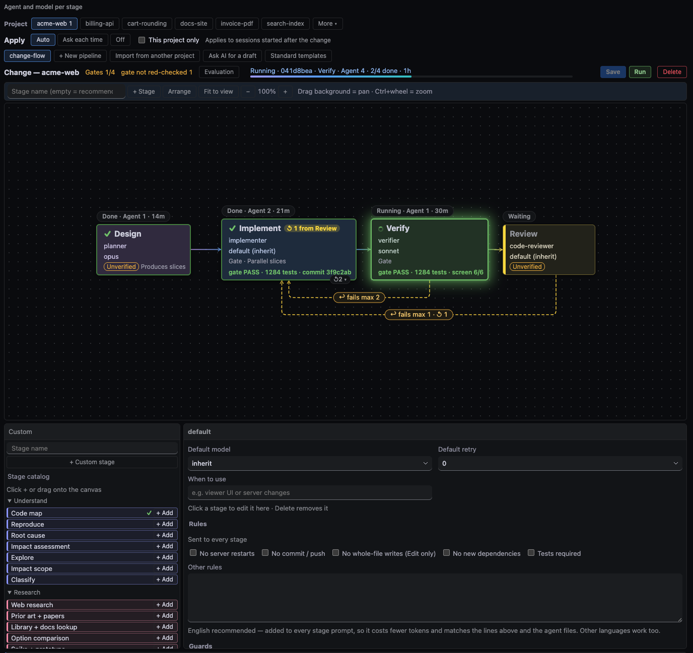
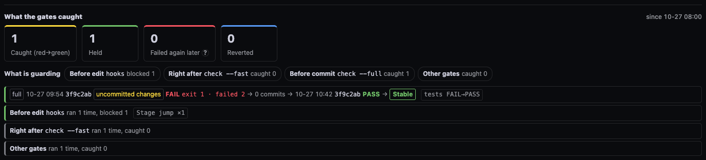
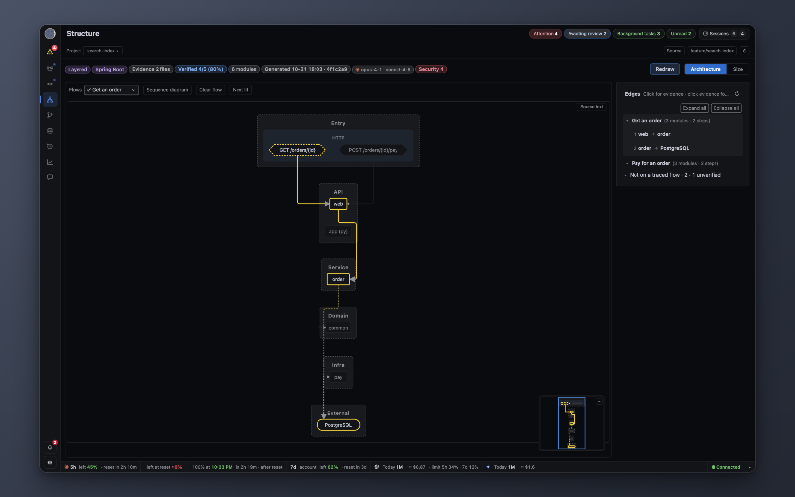
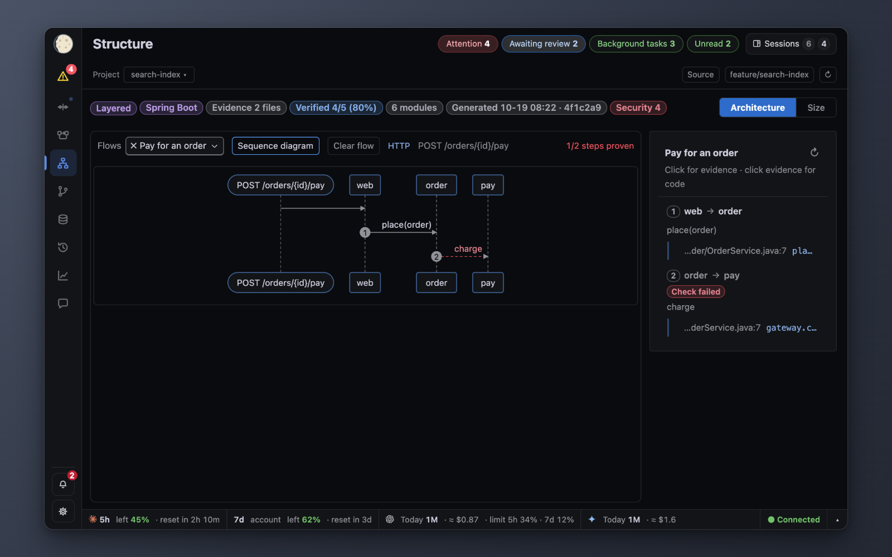
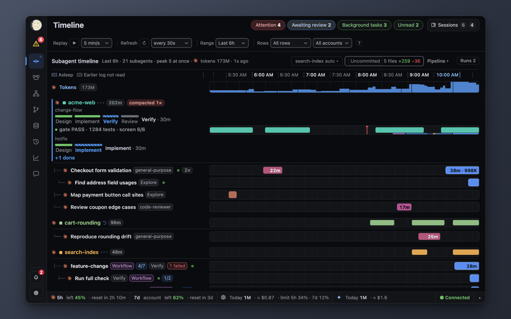
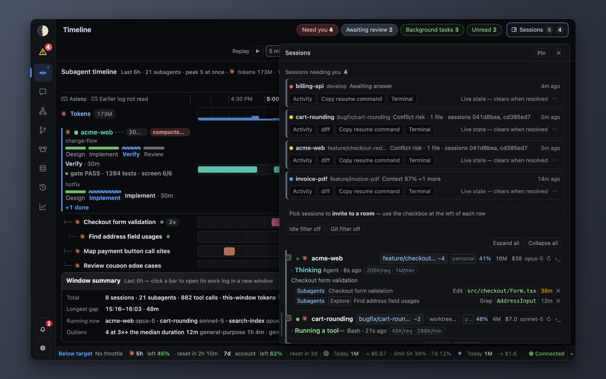
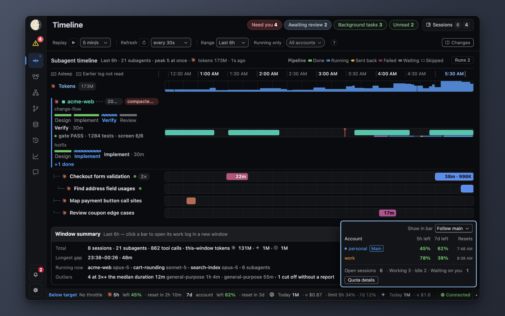
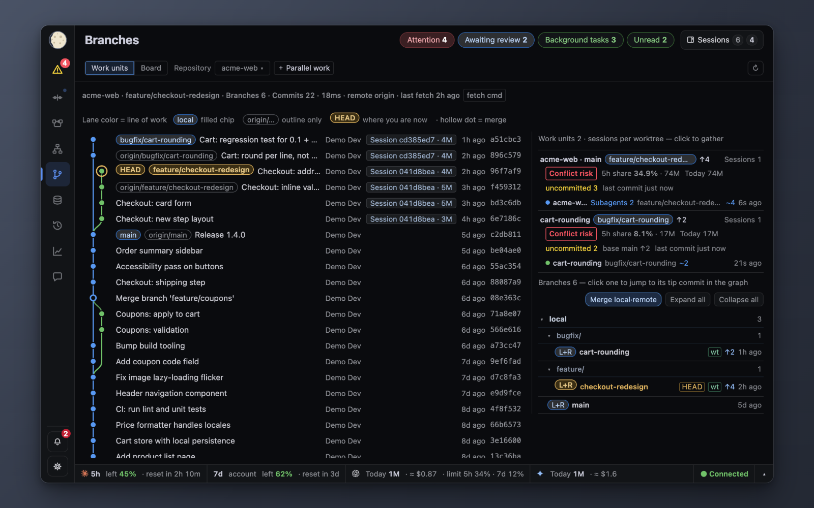
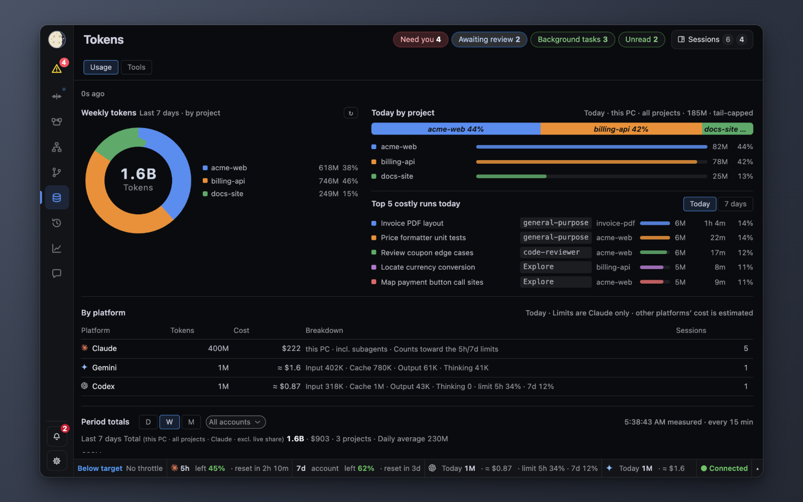

# User guide

**English** · [Korean](GUIDE.ko.md)

Install first: [GETTING-STARTED.md](GETTING-STARTED.md). Screenshots come from `python3 -m sidereus start --demo` (synthetic data).
The viewer opens on Pipelines (Timeline if the pipeline feature is off; a saved tab or tab order wins). The UI language follows the browser (English for `en*`, Korean otherwise); Settings › «Display language» overrides it.
The open tab is in the address (`/#pipelines`, `/#structure`, `/#timeline`, `/#chat`, …): a link opens that tab, and each window keeps its own tab; a new window without one opens the last chosen tab. Chrome «Install app» (address bar) runs the viewer in its own window.

Layout: a sidebar on the left (logo, «Attention» list, views, «Alerts» and settings). It is an icon strip by default; the toggle or Cmd/Ctrl+B widens it (remembered). From 1200px it pushes the page, below that it slides over it.
On the right: one top bar (view title, running sessions, «needs me» chips, session drawer), the view body, and the status bar at the bottom.

⚠ The screen shows metadata only (path, session id, model, one-line task). Conversation content appears only in a work log, after a click.

## Watch a pipeline run

The Pipelines tab shows a project's stages from `.claude/pipelines/*.json` and lights each stage while its agent runs.

### Working now (left list)
- Every live session, named as in the Timeline (logo, project, state), plus a one-line run summary: «● Working · <stage>», «● Needs you · <stage>» (amber), «● Idle · <stage>» (grey: run open, turn ended), «✓ <name> done». Without a run the row shows «No pipeline · <category>» or «Undeclared».
- Click a session to open its run on the right. A run that starts working (after a reload, the newest working one) opens by itself while no working run is shown; when the shown run ends or goes idle, the newest working one opens.
- Under each session: its subagents as in the Timeline (logo, type, one-line task, running dot). Running first, quiet ones dimmed, up to 6 then «+N more». Click one to open that run with its stage selected (when the agent is tagged).
- «‹» collapses the list to a rail of status dots (a dot click expands and opens it). Drag the edge to resize; the width is remembered.

### Watch view
Three stacked parts: canvas | selected stage's result | «Running N» card.
- Click a stage to select it. With nothing selected the pane shows the running stage, else the last finished one; with no run it is empty.
- If the selected stage was running, the selection moves to the next running stage while only one run is live.
- The pane shows the stage's outcome, loop-backs (↺), agent count and age, its gate evidence («No gate evidence for this stage yet» when none) and gate command («No gate command — nothing machine-checks this stage» when none). Agent buttons open that agent's work log.
- «Running N» lists every open run (project, pipeline, stage chips, agent count); click a row to open it. It stays in place with «No runs running», so runs starting or ending do not move the layout.
- Drag the grips between the parts to resize; double-click a grip for the defaults (canvas 75%, pane 14%, card 11% of the free height). Sizes are kept as shares, so a window resize keeps the proportions.
- The head row holds the pickers, the run bar, «✎ Edit» and «▶ Run».

### Pick a project and pipeline
- «Project»: search working, recent and all projects; «+ Add project» at the bottom; its folder picker suggests up to 8 «Recent session folders» (sessions in the last 14 days) — click one, then «Add this folder». «Pipeline»: this project's pipelines (⚠ = file breaks the schema, • = unsaved edits, a dot = running). The file's `use` line («When to use») shows under the head row in Watch and Edit and in the picker tooltip.
- «+ New ▾»: «+ New pipeline», «Import from another project», «Ask AI for a draft», «Start from a template». «+ New pipeline» appears only in a folder that has had one Claude session (the file lives in its `.claude/`).
- A project with no pipelines leads with «Ask AI for a draft» and «Start from a template»; the quick templates fold behind «Quick templates ▾», and «Apply» appears once the project has a pipeline. Pick one, preview, then «Confirm — create» writes `.claude/pipelines/<name>.json`.
- «Cross-review (Codex)» is a one-stage template: the session runs one read-only `codex exec` review of `git diff` with its own permissions, billed to your Codex account. One-shot, no follow-ups; Codex must be installed and logged in. Sidereus never starts Codex.
- «Apply» (in Edit: «Auto · Ask each time · Off») sets how new sessions in this project use pipelines.

### How stages light up
- A stage lights when an Agent description starts with `[pl:<pipeline>/<stage title>]`; a stage with no tagged run stays waiting. Sessions are reminded to tag.
- Work outside a pipeline is declared with `[pl-none:<category>]`. In a project with pipeline files, the first edit or commit with no open run and no declaration is denied once with the pipeline names.
- Tags and the file format: [EXTENDING.md](EXTENDING.md).

### Request a run
1. «▶ Run» (disabled with unsaved edits: save first).
2. In «Send a run request» pick the mode («Session runs it directly (default)» or «Workflow»; Workflow is not offered for Codex), the session (only sessions logged in to the mailbox), a one-line request, and optionally «Change models for this run only».
3. Check «Message to send», then «Confirm — send». A greyed button names what is missing in its tooltip.
- The session runs the pipeline with its own permissions; Sidereus runs nothing. A Codex session picks the request up when its current or next turn ends.

### Edit
- «✎ Edit» shows the palette («Stage catalog»), the editable canvas and the stage editor under an «Editing <name>» band. Gate counts, «Evaluation» and «Apply» live here.
- Rename a stage at the top of the stage panel. «Arrange» and «Fit to view» tidy the canvas. «Stage catalog»: «+ Add» or drag an item onto the canvas; ✓ items bring a gate command.
- Nothing changed: «Close» or Esc returns to Watch. Something changed: «Cancel» drops the edits (nothing written), «Save» (preview + confirm) writes and returns.
- Unsaved edits survive switching to Watch (• mark, «Unsaved changes — Edit to save»); a page reload drops them. The tab remembers the last mode.
- A new pipeline opens in Edit. A pipeline borrowed from another project is watch-only.
- A draft (template, AI draft or «+ New») shows «Draft — not saved yet»: «✓ Save this draft» writes it, «Cancel» or Esc closes it unwritten.

⚠ With unsaved changes Esc does nothing, and Esc never closes a draft while a menu or the run panel is open — a key never discards work.

### Other runs
- Workflow-tool runs appear as a read-only «Workflow» group.
- A pipeline defined in another project appears only while it runs here: a chip «<name> · from <project>» («Sidereus built-in» for `arch-map`) at the end of the head row opens its read-only canvas.

### Harness: did the work come out right?
«Harness» in the same tab.

- The top shows three numbers from the gate records: «Caught (red→green)» (a gate failed, a later run of the same gate passed), «Held» and «Reverted».
- «What is guarding» lists the local checkpoints — «Before edit» (hooks, «blocked n») · «Right after» (`check --fast`) · «Before commit» (`check --full`) — with their catch counts. Click one to show only its cards.
- One card per catch, newest first: red run (time · hash · exit code · failures) → fix commits → green run → held/reverted. A checkpoint that ran but caught nothing is one quiet card «ran n times, caught 0».
- «Gate runs» (folded) holds the raw run rows; «Config map» (folded) holds hooks, rule files, agents, MCP and skills.
- A lit stage card names its newest gate run: «gate PASS · N tests · screen a/b» or a red «gate FAIL». A stage with no gate gets an amber «Unverified» pill; «Gates n/m» counts machine-checked stages. Design and review are expected to stay unverified.
- «Guards» (stage panel, nothing selected): gates required before `git commit` and «Max loop-backs» ([HOOKS.md](HOOKS.md#guards-hookspl_guardpy-claude-code-only)).
- «Evaluation»: per-stage seeded-defect catch rate, red check and stability ([dev/PIPELINE.md](dev/PIPELINE.md#evaluation-seeds-red-check-flaky-gates)). «Suggestions»: «Fix it myself» fills the editor, «Ask AI» previews a request.
  - Terms: «Catch» = share of deliberately planted defects (seeds) the stage gate caught · «Red check» = the gate was run once on a deliberately broken copy and failed, proof it can catch a defect · «Holdout» = planted defects kept out of tuning, used only to check the score is not overfit. Hover a header for the same text.
- «Details» › «Results»: recorded check runs, newest first (with [`ev_hook.py`](HOOKS.md#ev_hookpy), test/build/lint commands from any project).
- «Config map» (folded): hooks, rule files, agents, MCP servers, skills; click a «problems» / «to check» count to step through.

⚠ Without Claude Code telemetry, hooks that print nothing leave no record: «no record» does not mean «never ran». With telemetry on ([CONFIG.md](CONFIG.md)), every Claude Code hook gets a full run count, and one that ran 0 times over 3+ covered days is flagged «did not run in N days».

## Read the code structure

The Structure tab opens on «Architecture», a diagram of the project's modules. «Project» is the same picker as in Pipelines.

### Read the diagram
- Only edges with checked evidence are drawn («Verified N/M»); «All edges» adds implied ones.
- Bands run top to bottom: layers for layered code, or where code runs (Entry · Client · Server · Stores). Hover a band for its meaning.
- Click an edge for its evidence, then the evidence for the code. Click a module to see it and its neighbours only.
- After «Generated»: the AI that drew the map (platform logo and model; each model when stages differed, stage names in the tooltip). Older maps show «Drawn by: unknown». An amber ⚠ «Generated …» badge means the map predates HEAD (tooltip: how far HEAD moved).
- Minimap bottom right: click or drag to move; its corner button hides it.

### Make or refresh it
- «Generate diagram» (none yet) / «Update diagram» (older than the code) / «Redraw» (at HEAD) → preview → «Confirm — send» asks an open session to run the read-only `arch-map` pipeline. The diagram draws itself when it arrives. It needs Sidereus run from a git clone; an installed package (pipx/uv) has no repository to run the pipeline from, and the disabled send says so.
- A row shows who received it (project · session · mailbox id) and its state: «Sent», «Running · <stage>», «Stopping», then «Stopped» / «Done» / «No session». It survives a reload. «Stop» (preview + confirm) asks the session to finish the current stage and start no more.

### Flows

- «Flows» lists one flow per entry point; ✓ = every step proven, a red dashed arrow = unproven step. Click an arrow for the code at that call.

### Top issues (security)
- «Top issues N» opens the findings (gitleaks, npm audit, osv-scanner, semgrep, bandit — `security-checks` pipeline). Secrets are never shown.
- «Run security check» sends a `security-checks` run request to a logged-in session (preview + confirm), or shows the command to copy when there is none; progress shows as for the diagram.
- «Request fix» sends the selected findings and asks the session to re-run the security check once the fix is committed. A scan older than HEAD marks the Security badge with ⚠ and a dashed border.
- The window header and the badge tooltip show the last check time («Last check MM-DD HH:MM · 3d ago»); it turns amber after 30 days.
- Filters: severity («All severities / High and above / Critical only») and tool. «Hide rule» hides a rule for this repo until «N rules hidden · Show»; the view changes only, files stay as they are.
- The window ends with the check history and «Last report» (newest `security-report-*.md` as plain text). AI review rows are marked «model-generated, unverified». The grip between the findings and the history list resizes them (drag or arrow keys; double-click / Home resets; the size is remembered).
- Scanner findings resolve when the same tool stops reporting them. AI findings stay open until `scripts/arch_checks.py --repo <repo> --mark <slug>@<file> resolved|false-positive`.

### Size and Markdown
- «Size»: a line-count treemap; «Code» switches Source / All / Tests, «Color» the colouring.
- The source viewer shows relative in-project Markdown images (png, jpg, gif, webp, svg, up to 5 MB); remote, secret or missing images stay as alt text.

How the diagram is built and verified: [STRUCTURE.md](STRUCTURE.md).

## Check the evidence in the Timeline

The Timeline is the evidence behind a verdict: what each agent actually did, and when.

1. Each session and subagent has a row; hover for the task. «Rows» › «Running only» hides finished subagents (remembered). Drag the name column edge to widen it (double-click resets). On a session row a red line marks a compaction, a dashed blue line a /clear.
2. A session running a pipeline gets a stage progress bar under its name (green done, striped blue current, amber sent back, red failed); click it to open the run in Pipelines. «Runs N» in the header lists open and just-ended runs, outlined in the worst run's colour (yellow «Stuck»).
3. The «Changes» chip counts files changed in the followed session against «Changes baseline» (default «Uncommitted»); «⚠ n shared» = two sessions touched one file. Click it for the diff; base buttons «Uncommitted», «Since session start», «vs main / master», «All»; «Include untracked files»; one tab per repo.
   Untracked secret files (`.env`, `.env.*` except `.example`/`.sample`/`.template`, `*.pem`, `*.key`, `*.p12`, `*.pfx`, private SSH keys, `.netrc`, `.npmrc`, `.pypirc`, `credentials`) are listed by name only: their contents are never read or sent, and the diff shows «(contents hidden: secret file)».
4. The bottom summary shows «Results» (commits, runs ✓/✕/↺) and «Evidence» (gate PASS/FAIL, first failing step); «More» adds waiting time, outliers and cost.
5. Click a commit for its diff, a session or agent for its work log. With a log open, clicks add tabs; Shift+click opens a new window.
6. Older work: the History tab (with 2+ accounts, an account picker; other accounts' Claude rows fold into «In other accounts: N»).

## Find the session waiting for you

1. Read the «Attention» list in the sidebar (a count badge when folded). Blocked and «Awaiting answer» sessions come first; a pending question stays until answered or its session is known to have ended.
2. Each row acts in one click: «Terminal» raises its tab, «Reply» opens a one-line box (Enter sends to that session's mailbox, Esc closes), «Done» hides that request, «Later» snoozes 30 min, «Seen» marks agent completions read. Clicking the row opens the session.
3. A session that ended its turn shows a «Done · waiting for input» row about 15 s later, under «N low-priority» with other done and background-done rows.
4. The session drawer in the top bar has the full list (running a tool, thinking, waiting, done, stalled). Click a row for its work log; with a terminal app set (iTerm2, Terminal.app, Orca), its tab comes forward too.

- Clicking a blocked or awaiting-answer alert anywhere (card, toast, row, OS notification) raises that session's terminal tab.
- The idle and git filter chips cycle on click (idle: off, 10, 30, 60 min; git: off, ↑ unpushed, ↑~ unpushed or dirty). The branch chip opens the session's diff.
- A Codex session without hooks shows «Hooks not connected» and only «Last activity N m ago» ([HOOKS.md](HOOKS.md)).

⚠ Orca opens the exact tab only with its CLI installed (Orca › Settings › General); otherwise only the app comes forward.

## Check whether quota lasts until the reset

1. The status bar shows 5-hour and 7-day usage. Click it (or Enter) for each account's 5h/7d left and reset time, and open sessions. «Quota details» opens the full window; Esc closes.
2. «left at reset» = projected headroom at the reset; «100% at» = when the 5-hour limit runs out at this pace. `≈` and `±N%` mark estimates that narrow as the window goes on.
3. With 2+ Claude accounts: colour bands, name chips, account pickers, and «Make main» on hover ([CONFIG](CONFIG.md#several-claude-accounts)).

The saver verdict changes only when the projection is more than 3 minutes past a boundary.

## Stop two agents editing the same file

1. When «Alerts» shows «Conflict risk», click it: it names the file and both sessions.
2. In Branches, pick the repository; each worktree card lists uncommitted files and their session.
3. To ask one session to stop, write in its work log's message box (preview, then the mailbox).

Sessions can check this themselves with the MCP tool `sidereus_file_peers` ([MCP.md](MCP.md)).

## See where tokens went

- Tokens: usage by model and project, running subagents, «Daily» (tokens, cost, top 2 projects per day; today's cost excludes the live share) and «Top 5 costly runs».
- Insights, for longer periods: «Tool ranking», «Time spent», «Cache rewrites», «Activity by hour» and «Models» (last 8 days), «Hook cost» (per event type, scripts are not named).
- With 2+ accounts the picker scopes only the period totals (Tokens) and the OTel cards (Insights); live figures stay all accounts.

## Manage chat rooms

Chat tab › «Manage» on the room list.

1. Hide: tick rooms, «Hide selected (N)», «Confirm». Unhide: «Hidden rooms N» › «Undo».
2. Create: «New room», name, pick sessions, check the preview, «Confirm». Invite: «Invite» on a card.

- Hiding changes the view only; posts stay in the mailbox (`room-admin.json` holds the list).
- Only logged-in sessions can be picked; invites go as mailbox DMs. «Participants» shows a platform logo for live sessions.
- The «To» line shows where Enter posts (`# room` or `DM → peer`). Red numbers count unopened posts (this browser only).

## First-visit tour

A short tour points at the screen, Pipelines first; steps for switched-off features are skipped. The last step shows `/plugin marketplace add <path>`.
Replay it from the «?» panel or Settings › «Replay the tour». `?tour=1` forces it, `?tour=0` suppresses it. A window driven by an agent shows an «Automated test window» strip (`?autobar=0` hides it).

## Change settings

Settings (gear), one tab per group. Screen values are stored on the viewer server and apply at once; server values (`config.local.json`) apply after a restart. A dimmed row has no effect right now (hover for why).

- «Display»: language, background tone (default «System»), text size, session list («Drawer» / «Pinned right»), token widgets, burndown curve, «Terminal integration» (Auto · iTerm2 · Terminal.app · Orca · Off).
- «Alerts»: «Alert level», «Group repeats per session (30 min)», «Cards in the alerts list», «Notify when a session waits for me» (OS notification, off by default).
- «Saver mode» (same file as `/saver`, every session): «Mode», «Target burn», «At the target limit» («Notify only» · «Warn, then allow» · «Block»), «What each level does».
- «Timeline»: replay speed, refresh, range, «Changes baseline», task description on subagent rows.
- «Preferences»: «Start view», «Moon mark», «Tab order and visibility» (Timeline cannot be hidden), «Main account», «Reset display settings», server values («My name», «Default room», «Advanced»: saver hook folder, «Port»), «Auto-compact» and «Compact threshold (tokens)», «Features», «Mailbox watch».
- «Diagnostics» (read-only): hooks on the same events, a CLAUDE.md shadowing AGENTS.md, hooks that look silently off, installed plugins, «Security tools».
- «Saved views» (when one exists): «Apply» switches to it.

⚠ «Auto-compact» and «Compact threshold» are written to each account's Claude Code `settings.json` (preview + backup) and apply to new sessions. «Features» changes apply on «Save», no restart.

Keys: [README «Customising»](../README.md#customising), [CONFIG.md](CONFIG.md).

## When something looks wrong

See [GETTING-STARTED.md](GETTING-STARTED.md#when-something-looks-wrong).
