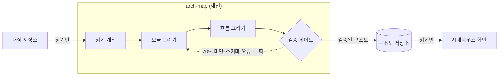
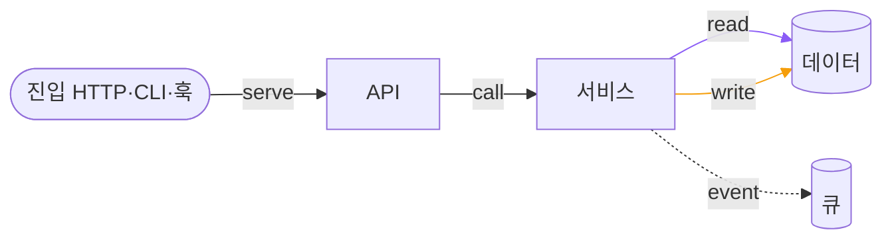

# 구조

[English](STRUCTURE.md) · **한국어**

구조 탭은 «아키텍처»(기본)와 «크기» 두 모드로 프로젝트를 보여 준다. 화면 사용법은 [GUIDE](GUIDE.ko.md#코드-구조-보기)에 있다.
시데레우스는 이름·경로·줄·개수 같은 메타데이터만 쓰고, 프로젝트를 고치거나 그 안에 쓰지 않는다. 코드는 누를 때만 열린다.

## 구조도는 이렇게 만들어진다

- 구조도는 세션의 에이전트가 그리고, 시데레우스는 검증된 결과를 읽어 보여 주기만 한다.
- 탭의 요청 버튼(«구조도 생성 요청» · «구조도 업데이트 요청» · «다시 그리기»)은 미리보기를 거쳐 고른 세션에 요청을 DM 으로 보낸다.
- 구조도가 HEAD 보다 오래됐으면 «오래됨» 으로 표시한다.

## 구조도에 담기는 것

- 모듈은 층(진입 → UI → API → 서비스 → 도메인 → 공용 → 인프라 → 데이터)에 놓이고, 층 안에서 그룹으로 묶인다.
- 연결: `import`·`call`·`config`·`di`, 그리고 `read`/`write`/`serve`/`event`. 선은 호출 실선, 읽기 보라, 쓰기 주황, 이벤트 점선이다. 연결마다 `파일:줄:심볼` 근거가 붙는다.
- 흐름은 진입점(HTTP 경로, CLI 명령, 작업, 이벤트, 훅, MCP 도구)마다 하나, 최대 40개, 각 40단계까지다. 흐름은 진입점의 핸들러에서 시작해 그 모듈의 다른 핸들러를 더하며, 여러 진입점이 한 모듈을 같이 쓰면 첫 흐름에만 넣고 40단계를 넘으면 얕은 것부터 남긴다.

## 어떻게 검증하나

- 인용된 파일을 구조도의 커밋 시점으로 다시 읽는다. 심볼이 ±2줄 안에 있고 출발 모듈 소속이어야 하며, 증명 못 한 연결은 버린다.
- 연결의 70% 이상이 통과해야 게이트를 넘는다. `config`·`di`·`event` 연결은 늘 «추정» 으로 표시한다.
- ⚠흐름은 참고용이다. 증명 안 된 단계는 표시만 하고 게이트는 바꾸지 않는다.

## 프로젝트 검사

«프로젝트 검사 실행» 버튼은 Sidereus 가 돌릴 수 있는 도구를 저장소가 설정해 둔 경우에만 보인다(Gradle/Maven checkstyle·pmd, ruff·mypy 설정, 로컬 바이너리가 있는 eslint/tsc, `go vet`, `cargo clippy`). 이미 기록된 결과는 어느 쪽이든 그대로 보인다.

## 보안 검사

`security-checks` 파이프라인이 gitleaks·npm audit·osv-scanner·semgrep·bandit 결과를 «주요 문제» 창 «보안» 탭에 보여 준다. ⚠비밀값은 저장하지 않는다.

## 크기

- 영역별 함수 줄 수 트리맵이다. «코드» 로 본코드·전체·테스트를, «색» 으로 색 기준을 바꾼다.
- 칸을 누르면 코드, 변경, 짝 테스트가 열린다.
- 언어: Java, Kotlin, Python, JS/TS, Go, JSP 내장. C/C++, C#, PHP, Ruby, Rust, Svelte 는 플러그인이다([언어 추가](EXTENDING.ko.md#언어-플러그인)).

내부 구조 — 저장 위치, map.json v2, API, 파일

### 화면

전체 보기는 층마다 가로 띠를 쌓고, 띠 안에 그룹마다 상자 하나, 외부 모듈은 종류(db, auth, api, jar)마다 상자 하나를 둔다.
선 범례는 도구 줄 아래에 있다. 빈 바탕을 끌면 화면이 움직이고, 모듈 클릭은 그대로 선택이다.
오른쪽 아래 미니맵이 구조도 전체와 지금 보이는 부분을 보여 준다. 누르거나 끌면 그 자리로 간다. «미니맵 숨기기» 를 누르면 칩만 남는다.

### 파이프라인

`.claude/pipelines/arch-map.json`: 읽기 계획 → 모듈 그리기 → 흐름 그리기 → 검증(`scripts/arch_verify.py --last`, 실패 시 모듈 그리기로 1회).
계획 단계에서 아키텍처 스타일(계층형, 헥사고날 등)을 정한다. 그 흐름을 벗어난 연결은 숨기지 않고 따로 보여 준다.

### 검증 규칙

`scripts/arch_verify.py` 는 `git show <커밋>:<파일>` 로 읽는다(작업 트리는 안 본다). 심볼 ±2줄(`ARCH_K`), 게이트 70%(`ARCH_GATE_MIN`).
흐름(`sidereus/arch_flow.py`)도 단계마다 같은 방식으로 검증하지만 연결 비율·게이트 종료 코드·`map.md` 에는 영향이 없다.

### 저장

`<데이터 폴더>/arch/<저장소 해시>/<커밋>/`(`plan.json`, `map.json`, `verify.json`, `flows.json`, `flows.verify.json`, `map.md`).

### 보안 검사

`scripts/arch_checks.py --repo <저장소> --category security [--net]` 가 `checks-security.json` 에 규칙·`파일:줄`·패키지만 남긴다.
⚠비밀값·일치 문자열은 저장하지 않는다. 의존성 조회는 `--net` 일 때만. semgrep 은 로컬 규칙만 쓴다.

### map.json v2

`v: 2` 는 계층과 데이터 흐름을 더한다. `v: 1` 구조도는 예전 규칙 그대로다(새 키는 거부).
층 정보가 없는 구조도는 예전 호출 깊이 배치로 그리고 «층 정보 없음 — 구조도를 다시 그리세요» 를 띄운다.

- `groups`: `{id, name, layer?}` 1–40개. 모듈마다 `layer`(`entry`, `ui`, `api`, `service`, `domain`, `data`, `infra`,
  `shared`)와 그 목록의 `group` 이 필요하다. 선택: `summary`(한 줄, 120자 이하), `owns`(저장소 모듈 id, 20개 이하).
- 모듈 종류 추가: `entry`(ext `http|hook|mcp|cli|file|job`, layer `entry`), `store`(ext `store|file|queue|db`,
  layer `data`). 둘 다 저장소 파일을 소유하지 않는다.
- 연결 종류 추가: `read`/`write`(store 로, 근거는 `from` 모듈), `serve`(entry 에서, 근거는 `to` 모듈), `event`(항상 추정).
  이들은 «대상에 정의됨» 검사를 건너뛴다.
- `role` 은 계층과 맞아야 한다(`web`→`api`, `view`/`viewmodel`→`ui`, `service`/`app`→`service`,
  `domain`/`model`/`port`→`domain`, `data`→`data`, `adapter`→`infra`, `shared`→`shared`).

### API

`GET /api/arch?path=<저장소>` 는 허용된 저장소의 가장 새 검증 구조도를 준다. `v`, `groups`, 모듈, 통과한 연결, `style`, `dev`, `flows`,
`stale`.

### 파일

`sidereus/arch_map.py`(`/api/arch`) · `arch_verify.py`(연결 검증, 저장) · `arch_flow.py`(흐름) · `arch_schema.py`(map.json 형식) ·
`structure.py`, `structure_scan.py`, `structure_lang*.py`, `structure_plug.py`(트리맵) · `structure_tree.py`(소스 창) ·
`arch_checks.py`(검사 결과) · `web/js/80`–`84k-structure*.js`, `web/js/84l-structure-arch-checks.js` ·
`scripts/arch_checks.py`(검사 실행).

