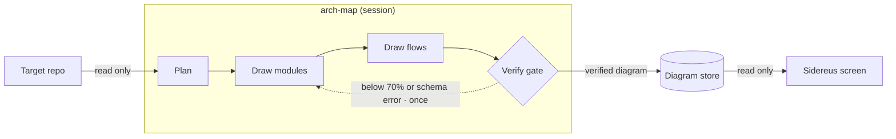
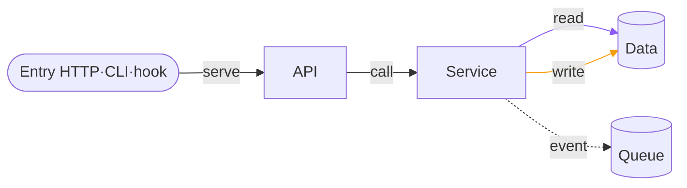

# Structure

**English** · [Korean](STRUCTURE.ko.md)

The Structure tab shows a project in two modes: «Architecture» (the default) and «Size». How to use the screen: [GUIDE](GUIDE.md#look-at-code-structure).
Sidereus uses metadata only (names, paths, lines, counts) and never edits or writes into the project. Code opens only when you click.

## How the diagram is made

- An agent in your session draws the diagram; Sidereus only reads the verified result and shows it.
- The request button in the tab («Generate diagram» · «Update diagram» · «Redraw») sends the request to a session you pick as a DM, after a preview.
- A diagram older than HEAD is shown as outdated.

## What a diagram contains

- Modules sit in layers (entry → UI → API → service → domain → shared → infra → data), grouped inside each layer.
- Edges: `import`, `call`, `config`, `di`, plus `read`/`write`/`serve`/`event`. Lines: call solid, read violet, write amber, event dashed. Every edge cites `file:line:symbol`.
- Flows: one per entry point (HTTP route, CLI command, job, event, hook, MCP tool), up to 40, 40 steps each. A flow starts at its entry's handler and adds the module's other handlers; when entries share a module, those go into the first flow only, and past 40 steps the shallowest are kept.

## How it is checked

- Each cited file is re-read at the diagram's commit. The symbol must sit within ±2 lines and belong to the edge's source module; unproven edges are dropped.
- At least 70% of edges must pass the gate. `config`, `di` and `event` edges are always shown as estimated.
- ⚠Flows are advisory: an unproven step is marked, but never changes the gate.

## Security checks

The `security-checks` pipeline shows gitleaks, npm audit, osv-scanner, semgrep and bandit findings in the issues window («Top issues N»). ⚠Secret values are never stored.

Its second stage, «Threat model review», has a model review the code against the repo's threat model (`.oss-scanner/threat_model.md` or `threat_model.md`) and logs findings to `security-log.jsonl`. These findings are model-generated and unverified. Without a threat model the stage prints one line pointing to `templates/oss-scanner/` and passes.

## Size

- A line-count treemap of functions per area. «Code» switches main / all / tests, «Color» the colouring.
- A click opens the code, its diff and its test pair.
- Languages: Java, Kotlin, Python, JS/TS, Go, JSP built in; C/C++, C#, PHP, Ruby, Rust, Svelte as plug-ins ([add a language](EXTENDING.md#language-plug-in)).

Internals — store, map.json v2, API, files

### Screen

The overview stacks one horizontal band per layer, with a box per group inside each band and one box per kind of external
(db, auth, api, jar). The line legend sits under the toolbar. Drag the empty background to move around; a click on a module
still selects it. The minimap in the bottom-right corner shows the whole map and the visible part; click or drag it to jump; «Hide minimap» folds it to a chip.

### Pipeline

`.claude/pipelines/arch-map.json`: Plan → Draw modules → Draw flows → Verify (`scripts/arch_verify.py --last`; on failure, back to Draw modules once).
The plan names an architecture style (layered, hexagonal, …). Edges that break it are listed, not hidden.

### Check rules

`scripts/arch_verify.py` reads files with `git show <commit>:<file>`, never the working tree. Symbol within ±2 lines (`ARCH_K`), gate 70% (`ARCH_GATE_MIN`).
Flows (`sidereus/arch_flow.py`) check every step the same way, but never change the edge rate, the gate's exit code or `map.md`.

### Store

`<data dir>/arch/<repo hash>/<commit>/` (`plan.json`, `map.json`, `verify.json`, `flows.json`, `flows.verify.json`, `map.md`).

### Security checks

`scripts/arch_checks.py --repo <repo> --category security [--offline] [--dev]` writes `checks-security.json`: rule, `file:line`, package only (dependency findings add optional `cve`: up to 3 CVE aliases, shown next to the GHSA rule; the finding key stays the rule).
Each run also writes one Markdown report, `arch/<key>/security-report-YYYYMMDD-HHMM.md` (newest 10 kept): tool status, findings, triage, delta since the previous scan, and the `scripts/deps_audit.py` lines when the repo is this Sidereus checkout (`--dev` adds the dev tooling).
⚠Secret values and matched text are never stored; advisory lookups (and semgrep registry packs when there is no local config) run online by default; offline or `--offline` = skipped, never «0 issues».

### map.json v2

`v: 2` adds layers and data flow; `v: 1` diagrams keep the old rules (the new keys are refused there).
A diagram without layers draws the older call-depth layout and says «No layers — redraw the diagram».

- `groups`: 1–40 `{id, name, layer?}`. Every module needs a `layer` (`entry`, `ui`, `api`, `service`, `domain`, `data`,
  `infra`, `shared`) and a `group` from that list; optional `summary` (one line, ≤120) and `owns` (store ids, ≤20).
- Module kinds add `entry` (ext `http|hook|mcp|cli|file|job`, layer `entry`) and `store` (ext `store|file|queue|db`,
  layer `data`). Neither owns repo files.
- Edge kinds add `read`/`write` (to a store; evidence in the `from` module), `serve` (from an entry; evidence in the `to`
  module) and `event` (always estimated). These skip the «defined in target» check.
- A `role` must match its layer (`web`→`api`, `view`/`viewmodel`→`ui`, `service`/`app`→`service`,
  `domain`/`model`/`port`→`domain`, `data`→`data`, `adapter`→`infra`, `shared`→`shared`).

### API

`GET /api/arch?path=<repo>` returns the newest verified diagram of an allowed repo: `v`, `groups`, modules, passed edges,
`style`, `dev`, `flows`, `stale`.

### Files

`sidereus/arch_map.py` (`/api/arch`) · `arch_verify.py` (edge check, store) · `arch_flow.py` (flows) · `arch_schema.py` (map.json format) ·
`structure.py`, `structure_scan.py`, `structure_lang*.py`, `structure_plug.py` (treemap) · `structure_tree.py`
(source window) · `arch_checks.py` (security check results) · `web/js/80`–`84k-structure*.js`, `web/js/84l-structure-arch-checks.js` ·
`scripts/arch_checks.py` (security check runner).

